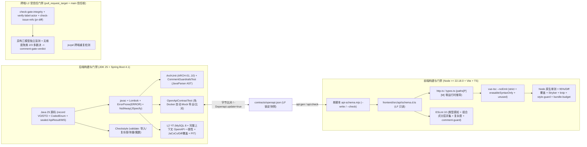

# 愈爪平台代码质量与工程护栏体系设计（质量前置护栏、栈基线升级、类型契约、架构门禁、LLM 注释审查与测试质量闭环）

*   **Author:** chake111
*   **Status:** Proposed (Unified Post-EGM, External Review & Draft R3 Sign-Off)
*   **Date:** 2026-11-24

---

## Overview

本设计方案面向「愈爪|宠物医院预约与在线问诊平台」（当前后端 Spring Boot 3.5.16 + JDK 17 + MyBatis-Plus 3.5.17 + MySQL 8，前端 Vue 3 + Vite + Element Plus 单工程双端路由），针对项目在 AI 辅助持续迭代中缺乏注释反噪音与语义校验、复杂度/死代码/重复代码约束、编译期类型与空安全门禁、架构边界校验以及增量测试行为验证的问题，建立覆盖全生命周期的自动化工程护栏体系。

本方案采用**「先在现存栈前置上线基础质量与注释/防绕过护栏（里程碑 0.5），再经 Stage 0 Spike 验证后升级至 JDK 25 LTS + Spring Boot 4.1 并按可评审粒度分 PR 推进全量存量清零、无按文件冻结清单」**的演进路径，使后续迁移 PR 自第一天起即受护栏保护。在不破坏现有 MySQL 表结构与已消费 HTTP/WebSocket JSON 契约的前提下（移除原 Entity 误暴露的未消费内部/敏感列除外），体系包含六个正交支柱：

1. **前置基础护栏与防绕过防线（里程碑 0.5，基于现存栈立即生效）**：建立 `CODEOWNERS` 与分支保护、基于全仓实测基线定值的复杂度/体量门禁、死代码/重复代码扫描、全文件反噪音注释机检、抑制项只减不增棘轮，以及基于 `pull_request_target` 信任根与三异构模型独立盲测的 L2 LLM 注释评审门禁（先 `advisory` 灰度，后切 `enforce`）。
2. **后端栈基线升级与编译期空安全/架构门禁**：经 Stage 0 Spike 验证后升级至 JDK 25 LTS + Spring Boot 4.1（含 Jackson 3、`mybatis-plus-spring-boot4-starter`、SpringDoc 3.2.x），落地 `ErrorProne + NullAway (JSpecifyMode + OnlyNullMarked)`、`Checkstyle`、`ArchUnit`（10 条规则）与 `CommentGuardrailsTest`（JavaParser AST），不引入与编译期分析重叠的 `SpotBugs`。
3. **后端领域强类型收口、鉴权 Fail-Closed 与 OpenAPI 导出**：收口 15 个 `CodedEnum` 枚举、全站 `@PublicEndpoint` 与后台 Fail-Closed `@RequireRole(AdminRole[])`、22 个无实体依赖的不可变 VO `record`（Service 内静态 `toVo` 装配，不设独立装配包）、15 个表单 DTO 与 13 处 `@Valid`、三态密封 `ApiResult`、15 个 WebSocket 密封帧与离线 `OpenApiContractTest`。
4. **前端测试逻辑下沉、全量严格 TypeScript 与 `paths[P][M]` 契约绑定**：将 4 个正则 + `new Function` 单测解析的 10 个 `.vue` 逻辑与 3 处模板表达式下沉为纯 `.ts` 模块，按目录分 3 个 PR 完成全量严格 TS 迁移（启用 `erasableSyntaxOnly`、`noUnusedLocals`、`noUnusedParameters`）、组件跨端解耦、ESLint 10 组合式并集禁导与基于 `import type { paths }` 的零运行时端点类型推导。
5. **反转默认的注释治理与 L2 异构多评审 LLM 阻断门禁**：取消全量存在性文档注释强制要求，改为「默认不写注释 + 高风险白名单限定 Javadoc/JSDoc + 全文件非文档注释统一 `原因:` / `TODO(#n):` 前缀白名单 + 指令型注释显式豁免 + L2 三异构模型独立盲测无维度聚类 2/3 多数决阻断」，并以人机独立身份与服务端统一标签 Actor 校验防止 AI 自审绕过。
6. **修订 `AGENTS.md` 规矩三，补齐增量测试行为质量门禁**：保留既有 3 个核心文件的 95% 全局覆盖率门禁不变，新增 PR 增量 diff 行覆盖率（L2 阻断，后端及前端纯 TS 逻辑均 `>= 80%`）与 PIT（Java）/ Stryker（TS）增量变异测试（目标 `>= 70%`，先 `advisory` 跑在 L2 观察 3–5 个 PR 后切 L2 阻断，并设 `SPK-07` 前置验证 PIT 在 JDK 25 的兼容性）。

## The Problem

项目当前在并发不变量（`*IT` 集成测试）、CSS 与表格规范（`style-guard`）及首屏包体（`bundle-budget`）上已有局部自动化防护，但在**注释噪音与可读性、代码复杂度与死代码、类型与空安全、架构边界、防门禁绕过及增量行为验证**六个维度仍缺乏机械约束。

对照 2026-11-23 至 2026-11-24 对仓库全量源码（后端 122 个 Java 主源码文件、24 个测试文件；前端 82 个 JS/Vue 源码文件、11 个测试文件）的静态与词法扫描实测，问题如下：

### 1. 注释缺反噪音、防漂移与语义校验，全量强制注释反而制造噪音

*   **存量全景实测（可由 `tools/comment-audit-baseline.mjs` 复现）**：204 个源文件共有 **279 条**非文档注释（后端 129 条整行 `//`；前端 150 条，含 125 条整行 `//`、7 条行尾 `//`、14 条 `<script>` 非 JSDoc `/* */`、4 条 `<template>` `<!-- -->`）与 **564 个**既有 Javadoc/JSDoc 块；后端有 **5 个文件**注释密度超过 35%（最高 `TraceIdFilter.java` `43.7%`）；全仓残留 **5 处**已过时的 `axios` 注释。
*   **存在性门禁与语义盲区**：单纯检查“是否存在注释”会诱导 AI 对纯数据载体与透传方法批量生成复述标识符的样板废话；而注释是否有信息量、是否与代码实现漂移、是否夹带 Prompt Injection，静态规则无法判定。

### 2. 代码复杂度、死代码、重复代码与测试行为质量缺乏约束

*   **全仓复杂度基线实测**：
    *   后端 391 个方法：`MethodLength` p95 = 27 行、最大 83 行，仅 **3 个方法**超过 60 行（`AppointmentService.doCreate` 83L、`buildVos` 66L、`DoctorScheduleService.update` 64L）；`CyclomaticComplexity` p95 = 7、最大 20，仅 **3 个方法**超过 15（`ConsultService.send` 20、`DoctorReviewService.submit` 17、`DoctorScheduleService.update` 17）；`ParameterNumber` 最大 5，`NestedIfDepth` 最大 1。
    *   前端 243 个顶层函数：`max-lines-per-function` p95 = 24 行、最大 81 行，`complexity` 最大 42，仅 **2 个函数**同时超过 60 行与复杂度 15（`ConsultPanel.vue:onFrame` 81L / CC 42、`http.js:request` 79L / CC 27）；`max-depth` 最大 3，`max-params` 最大 4。
*   **工具与验证缺口**：缺少复杂度/体量拦截、`knip` / `noUnusedLocals` 死代码检测、`jscpd` 跨端重复检测、ErrorProne 高信号缺陷提级，以及面向 AI 新增代码的增量 diff 覆盖率与变异测试；测试代码也缺少防无断言空测试与抑制棘轮基线。

### 3. 缺乏防 AI 篡改门禁与独立人机审批防线

*   若未通过 `CODEOWNERS`、受信任主干执行边界（`pull_request_target`）与人机双身份隔离保护门禁配置，拥有分支写权限的 AI 代理可以直接改弱 `checkstyle.xml`/`eslint.config.js`、在 PR 脚本中读取 LLM 密钥、自建 Issue 刷过 `TODO(#n)` 检查、或为自身 PR 贴上放行标签。

### 4. 后端依赖基线过旧且存量架构边界未隔离

*   **栈基线**：Spring Boot `3.5.16` 已于 2026-06-30 结束免费 OSS 补丁支持；在 JDK 17/21 + Jackson 2 + SpringDoc 2.8 上先做定制器会在升 Boot 4 时返工，而 JDK 25 LTS 原生支持 NullAway `JSpecifyMode=true`。
*   **存量高风险写法**：20 个 Controller 中 **13 个**直出 `entity.*`、**7 个** VO 继承 Entity、**2 个** VO 内嵌 Entity；**26 处** `Map<String, Object>` + 1 处 `Result<Map<String, String>>`；全库仅 **1 个**业务枚举；**9 个** Controller 共 **13 处** `@RequestBody` 缺 `@Valid`；**2 处**端点缺 `@Operation`（`ConsultController.detail`、`AdminConsultController.detail`）；**9 处** `BeanUtils.copyProperties`、**29 处 / 26 文件**通配符导入、**4 条**顶层包循环依赖；**5 个**后台 Controller 存在未标 `@RequireRole` 端点，`/admin/**` 拦截器默认放行（Fail-Open）。

### 5. 前端全纯 JS 无类型检查，且 4 个现有单测依赖正则执行 `.vue`

*   `frontend/src` 全部 82 个源码文件（24 个 `.js` + 58 个 `.vue`）无类型检查，`api/user.js`（32 导出）与 `api/admin.js`（57 导出）与后端 OpenAPI 脱节；`ConsultPanel.vue` 跨端导入双端 API，`PetForm.vue`/`PaymentTicket.vue` 位于通用 `components/` 却导入 `@/api/user`；`package.json` 残留未使用的 `axios`。
*   现有 4 个核心业务单测通过 `readFileSync` + 正则 + `new Function` 解析 **10 个 `.vue` 文件**（含 `ImageGallery.vue` 与双端 `ConsultRoom.vue`）及 `Schedules.vue` 中的 **3 处模板内联表达式**，直接改 `<script setup lang="ts">` 会在 V8 报 `SyntaxError`。

## Terminology & Definitions

| 术语 / 口径 | 定义 |
| --- | --- |
| **无按文件冻结清零** | 不使用 ArchUnit `FreezingArchRule` 或按文件路径忽略的长期债务清单；按规则族与目录分 PR 启用，每类规则一经启用即清零对应范围全部存量违例。 |
| **线格式兼容（Wire Compatibility）** | 保持 MySQL 表结构不变；HTTP REST 与 WebSocket 已消费 JSON 字段名及状态编码值维持兼容（剔除原 Entity 误暴露的未消费内部/敏感列，及已确认无消费方读取的 `MessageVisibilityFrame` `hidden=1` 省略空对象 `message` 除外）。 |
| **可擦除 TypeScript 子集** | 启用 `erasableSyntaxOnly: true`（禁用 TS `enum`、`namespace`、构造参数属性），保证 Node `>= 22.18.0` 原生执行 `.ts` 单测且 TS 语法不产生额外运行时代码。 |
| **风险触发型注释反转策略** | 默认不写注释；文档注释（`/** ... */`）只允许且强制出现在高风险白名单边界；全文件任意位置的非文档注释统一仅允许 `原因:`、`TODO(#<n>):` 及显式列举的指令型注释；语义质量由 L2 异构三模型阻断门禁兜底。 |
| **人机双身份与统一 Actor 校验** | AI 代理使用独立受限 Bot 账号推送分支与创建 PR；所有受控标签（`comment-gate:override`、`guardrail:tracked`、`guardrail:budget-approved`）不依赖 GitHub 标签权限假设，统一由 `main` 分支受信任脚本调用 Issue Events API 校验贴标人为维护者名单内人类账号且非 PR 作者。 |
| **项目既有核心门禁概念** | **首屏 16 文件**：`eslint.config.js` 锁定的首屏直达路径（入口关键路径 `<= 85 KB gz`）；**`style-guard`**：视觉 token 与表格密度门禁（`tools/style-guard/index.mjs` 与 `src/utils/tableDensity.ts` 保持 95% 覆盖率）；**`SchedulerLease`**：`com.yuzhua.task` 数据库互斥租约；**JWT 历史密钥黑名单**：`JwtUtils` 中严禁改写的弱密钥校验清单。 |

## Goals

### 1. 里程碑 0.5 前置基础质量、注释治理与防绕过护栏（在现存栈先行落地）

*   在不动 JDK 17 / Boot 3.5 / Vue JS 业务框架的前提下，先行上线受 `CODEOWNERS` 保护的 Checkstyle 复杂度与基础规则、`CommentGuardrailsTest`（JavaParser AST）、前端 ESLint 复杂度与 `eslint-plugin-comment-guard.mjs`、`jscpd` 查重、`.guardrails/*` 抑制棘轮、存量 279 条非文档注释与 564 个文档块清零，以及 L2 LLM 注释评审工作流（`advisory` 模式）。
*   拆解全仓 **7 处超标复杂度热点**（后端 4 个 Service 共 5 个方法：`AppointmentService.doCreate`/`buildVos`、`ConsultService.send`、`DoctorReviewService.submit`、`DoctorScheduleService.update`；前端 2 个函数：`ConsultPanel.vue:onFrame`、`http.js:request`），锁定后端 `CC <= 15` / `MethodLength <= 60` / `Params <= 6` / `NestedIf <= 2` 与前端 `complexity <= 15` / `max-lines-per-function <= 60` / `max-depth <= 3` / `max-params <= 5`。

### 2. 后端栈基线升级与正交静态/架构门禁

*   经 Stage 0 Spike（`SPK-01/02/03/07`）验证并锁定精确版本后，升级至 **JDK 25 LTS + Spring Boot 4.1**。
*   落地四项职责正交的后端门禁（移除 `SpotBugs`）：`ErrorProne（高信号规则提级 ERROR）+ NullAway（JSpecifyMode + OnlyNullMarked）`、`Checkstyle`（导入、复杂度、魔数、基础语法）、`ArchUnit`（`ARCH-01 ~ ARCH-10`，为含字节码陷阱的自写谓词配负例测试）与 `CommentGuardrailsTest`（Java AST 注释治理与测试代码基线）。
*   清零全部 4 条顶层包循环依赖（迁出 `com.yuzhua.props` 与 `com.yuzhua.consult.ws` 网关）、29 处通配符导入、9 处 `BeanUtils.copyProperties`、13 个直出 Entity 的 Controller、9 个耦合 Entity 的 VO、26 处 `Map<String, Object>` 与 13 处缺失 `@Valid`；落地 15 个 `CodedEnum`、三态密封 `ApiResult`、15 个 WS 密封帧与全站 `@PublicEndpoint` / 后台 Fail-Closed `@RequireRole(AdminRole[])`。

### 3. 前端逻辑下沉、分目录严格 TS、`paths[P][M]` 契约闭环与死代码检测

*   将 4 个正则 + `new Function` 测试解析的 10 个 `.vue` 逻辑与 3 处 `Schedules.vue` 模板表达式下沉为纯 `.ts` 模块，全部单测改为 Node `>= 22.18.0` 原生 ESM 导入执行。
*   分 3 个目录级 PR 完成 `frontend/src` 全部 82 文件严格 TS 迁移（含 `Dashboard.vue` 与 `PetPicker.vue` 双 `<script>` 块）、组件跨端解耦（`ConsultPanel` prop 注入、`PetForm`/`PaymentTicket` 迁入 `views/client/components/`、`api/common.ts`）、ESLint 10 组合式并集禁导、`paths[P][M]` 零运行时端点契约推导、`noUnusedLocals`/`noUnusedParameters` 与 `knip` 死代码拦截。
*   复用 `element-plus/global` 声明，不提交 `src/components.d.ts`；守住首屏 `<= 85 KB gz` 预算与 32 张 UI 截图基线。

### 4. 反转默认注释治理与防绕过 L2 LLM 阻断门禁

*   实现全文件无漏网的 L1 确定性反噪音检查（Javadoc/JSDoc 仅限高风险白名单、非文档注释全文件统一 `原因:`/`TODO(#n):`、指令型注释显式豁免与禁令、禁注释代码/变更叙述/超密度/废弃词、人类 `guardrail:tracked` Issue 校验与抑制棘轮、测试断言白名单）。
*   部署 `pull_request_target` 受信任执行边界 + `comment-gate-verdict` 必填汇总 job + 三异构模型各自独立 Pass 1 盲测与 Pass 2 三维评审 + 无维度聚类 2/3 多数决 + `PROMPT_INJECTION` 零容忍阻断 + `labeled` 人工留痕 Override；经 55 条红队样本与 20 条黄金样本回归达标后由 `advisory` 切为 `enforce`。

### 5. 修订 `AGENTS.md` 规矩三：增量 diff 覆盖率与 PIT / Stryker 变异测试

*   保留既有 3 文件 95% 全局覆盖率门禁不变，新增 PR 增量 diff 行覆盖率（L2 阻断，后端及前端纯 TS 逻辑均 `>= 80%`）与增量变异测试（PIT / Stryker，目标 `>= 70%`，先 `advisory` 跑在 L2，SPK-07 确认 JDK 25 兼容并观察 3–5 个 PR 后切 L2 阻断）。

## Non-Goals

*   **不做破坏性数据库或已消费协议改版**：不新增破坏表列的 DDL 迁移，不改变已消费 HTTP/WebSocket JSON 字段名与状态数值编码（移除误暴露的未消费内部/敏感列及无消费方读取的 `MessageVisibilityFrame` `hidden=1` 空 `message` 除外）。
*   **不引入 `SpotBugs`、Vitest/Jest 或第三方运行时 HTTP 客户端**：保持后端工具正交，前端维持原生 `fetch` 与 `node --test`。
*   **不强行要求存量老代码补齐全局覆盖率**：修订后的 `AGENTS.md` 规矩三仅对 PR 增量改动代码施加 diff 覆盖率与增量变异门禁，不推高全仓历史存量覆盖率门槛。
*   **不改写历史归档证据、JWT 历史密钥黑名单与品牌沿革记录**：既有 `docs/test-evidence/**` 目录、`JwtUtils` 历史密钥黑名单与 `docs/品牌沿革.md` 旧名记录保持只读；本次验收证据归档至新日期子目录。
*   **不在迁移期自建 `oasdiff` / 全接口 Golden JSON 回放脚手架**：迁移期线格式回归直接复用现有 8 个 `*IT` + 9 个 `tools/*_check.mjs` + `OpenApiContractTest` 断言；`oasdiff` 留待新契约基线确立后用于后续常规 PR 防破坏性变更。
*   **不重做业务功能或视觉设计**：页面布局、交互流程与 32 张 UI 截图基线保持不变。

## Open Questions & Stage 0 Feasibility Spike

以下 **4 项高不确定性后端工具链交互**在里程碑 0.5 落地后、PR 1 启动前，通过 **2–4 天的 Stage 0 Spike**（独立临时分支，不改主干业务）逐项实测闭合；**必须将实测锁定的精确版本号、容器镜像 tag 与受控 NullAway 白名单回写进本计划后，才解锁 PR 1**。（前端 ESLint 10 插件、Node 22 `.ts` 覆盖率与 Vue 宏 3 项低成本烟测下沉至前端 PR 5A 第一步执行。）

| 编号 | 待验证问题 | Stage 0 Spike 验证动作与出口标准 | 不通过时的降级预案 |
| --- | --- | --- | --- |
| **SPK-01** | Spring Boot `4.1.x` + JDK 25 下 `mybatis-plus-spring-boot4-starter`、Jackson 3、`jjwt` 与 SpringDoc `3.2.x` 是否全量兼容并跑通现有 8 个 `*IT` | 在 Spike 分支升级 POM 与 Jackson 3 适配（含 `JsonMapperBuilderCustomizer`、`javatime` 与 `TypeReference`）；若 `jjwt` 尚未原生支持 Jackson 3，优先用 Jackson 2/3 并存或 `JwtUtils` 轻量序列化桥接解决，跑通 `mvn verify` 全部 8 个 `*IT` | 仅当 `mybatis-plus` 或 Spring Boot 4 核心出现阻断级缺陷时，回退维持 Spring Boot `3.5.16` + JDK 25，并在文档记录阻塞 issue 与返工隔离边界 |
| **SPK-02** | JDK 25 + Lombok `1.18.42+`（`-proc:full`）+ ErrorProne `2.43+` + NullAway（`JSpecifyMode=true`, `OnlyNullMarked=true`）+ `javaparser-core` Java 25 解析是否存在编译冲突或 lambda 误报失控 | 在 Spike 分支接入处理器链、高信号 ErrorProne `:ERROR` 规则与 `CommentGuardrailsTest`，抽样标注核心 Service 与 `AppointmentMapper`，确认 `mvn test` 通过并盘点 JSpecify lambda 误报 | 若遇 JSpecify 上游 lambda 误报，在受控 PR 中按规程申请 `.guardrails/suppression-budget.json` 配额并挂 `open` + `guardrail:tracked` Issue；若 `javaparser-core` 对 Java 25 语法解析异常，校验 `LanguageLevel.BLEEDING_EDGE` 或锁定兼容版 |
| **SPK-03** | SpringDoc `3.2.x` 自定义转换器对 `@NullMarked`/`@Nullable`、`@Schema(nullable = true)`、`CodedEnum` 整型枚举、`ApiResult` 三态与 15 个 WS 帧字面量 `type` 能否生成可供 `openapi-typescript` 无损推导 `paths[P][M]` 与 WS 判别联合的 `schema.d.ts` | 用 Spike 样例导出 OpenAPI JSON 并运行精确锁版的 `openapi-typescript`，编译验证 `paths[P][M]` 推导、WS `if (f.type === 'HISTORY')` 类型收窄与 3 个可置空字段 `nullable` 类型 | 若 OpenAPI `3.1` 某结构生成异常，切换 `springdoc.api-docs.version=openapi_3_0` 并复测 |
| **SPK-07** | `pitest-maven` + `pitest-junit5-plugin`（及其内置 ASM）是否支持 JDK 25 字节码（classfile major 69）与增量 git diff 类变异执行 | 在 Spike 分支对 `AppointmentServiceTest` 与 `DoctorScheduleServiceTest` 试跑 PIT，确认无 `Unsupported class file major version 69` 且能在可接受耗时内输出 XML/HTML 报告 | 若 PIT 尚未发布 JDK 25 兼容版，保留 Java 增量 diff 覆盖率与前端 Stryker 变异门禁，为后端 PIT 建 `guardrail:tracked` 跟踪 Issue 待上游发布后启用 |

## Critical User Journeys (CUJs)

### CUJ 1：AI 提交带噪音注释、死代码或试图绕过门禁的 PR 时在 L1 / L2 被阻断

*   **Given**：里程碑 0.5 已上线，`CODEOWNERS`、L1 注释与复杂度门禁、`check-gate-integrity.mjs`、L2 `comment-quality-gate.yml`（`pull_request_target`）与人机双身份已生效。
*   **When**：AI Bot 在 PR 中写入逐行复述注释、被注释掉的代码、行尾注释、给非白名单类加 Javadoc、在分支里篡改 `.github/scripts/**`、伪造未打人类 `guardrail:tracked` 的 `TODO(#999)`，或写入 Prompt Injection 尝试诱导 LLM 放行。
*   **Then**：L1 直接给出面向 AI 的修正指示（删除复述或改写为 `// 原因:`）；L2 从 `main` 受信任副本运行脚本，PR 分支的脚本篡改不被执行且无法接触 LLM 密钥，三异构模型独立盲测按无维度聚类 2/3 多数决阻断废话/漂移注释，注入命中直接零容忍 `FAIL` 且不可 Override；Bot 给自身贴放行标签被 `verify-label-actor.mjs` 拒绝。

### CUJ 2：后端修改接口路径、参数、VO 字段或响应类型后触发前端编译期报错

*   **Given**：后端已完成强类型与 OpenAPI 契约导出，`contracts/openapi.json` 与 `frontend/src/api/schema.d.ts` 已入库（LF 锁定），前端 `http.ts` 基于 `paths[P][M]` 推导端点类型。
*   **When**：开发者或 AI 修改某 VO 字段/可空性、更改路径或查询参数名、或替换接口返回类型。
*   **Then**：未同步契约时 `OpenApiContractTest` 或 `npm run api:check` 失败并提示运行 `node tools/sync-api-contract.mjs`；同步后 `vue-tsc --noEmit` 在编译期指出全部受影响的 `.ts`/`.vue` 调用点。

### CUJ 3：新增后端接口或服务方法时受空安全、架构、复杂度与增量行为测试共同约束

*   **Given**：JDK 25 + Spring Boot 4.1 与全部后端门禁已上线。
*   **When**：新增后端逻辑出现直出 Entity、漏 `@Valid`、漏 `@Operation`、未标 `@RequireRole`/`@PublicEndpoint`、漏判 `@Nullable`、新包漏建 `@NullMarked` `package-info.java`、圈复杂度超 15、或测试未覆盖新增分支/断言无效。
*   **Then**：L1 `mvn test` 在免 Docker 下拦截编译、空安全、架构与复杂度违例；L2 CI 拦截低于 80% 的增量 diff 行覆盖率，并由 PIT 增量变异测试暴露弱断言测试。

### CUJ 4：修改前端页面或首屏模块时受严格 TS、分层隔离、死代码与包体预算约束

*   **Given**：前端 82 文件已完成分目录严格 TS 迁移，组合式并集 ESLint 10、`knip`、Stryker 与 `bundle-budget` 已启用。
*   **When**：在 `<script setup lang="ts">` 或 `.ts` 中引入 `any`、`@ts-ignore`、未 `await` 的异步调用（注：类型感知 `no-floating-promises` 覆盖 `<script>` 与 `.ts`，不覆盖 `.vue` 模板内联表达式）、跨端导入、无用导出或拉高首屏体积。
*   **Then**：`npm run lint`、`npm run typecheck`、`npm run deadcode` 与 `npm run bundle-budget` 定位违例并阻断合入；增量纯 `.ts` 逻辑测试通过 Node 22 原生执行并接受 80% diff 覆盖率与 Stryker 增量变异检验。

## Technical Plan (Architecture)

### 1. 整体架构与跨栈契约闭环

体系以「后端 Java 领域与契约模型为单一事实源」构建跨栈闭环，通过提交入库（LF 锁定）的 `contracts/openapi.json` 解耦前后端并行 CI，并在外围叠加跨端注释、重复代码、增量覆盖率与变异测试门禁：



核心架构取舍：
*   **高频门禁驻留 L1（免 Docker）**：编译期空安全、Checkstyle、ArchUnit、`CommentGuardrailsTest`、`OpenApiContractTest`、`vue-tsc`、ESLint 10、Node 原生单测均在 L1 执行；重型数据库集成测试、增量 diff 覆盖率、增量变异测试、`knip`/`jscpd` 与 LLM 注释语义门禁放在 L2 并行执行。
*   **双端 CI 并行解耦**：后端校验 Java 代码与 `contracts/openapi.json` 一致，前端校验 `contracts/openapi.json` 派生的 `schema.d.ts` 一致与 `vue-tsc` 通过，由仓根 `tools/sync-api-contract.mjs` 一键同步。

### 2. 后端栈基线、四工具正交门禁与架构解耦

*   **栈升级基线**：经 Stage 0 Spike 锁定精确版本后升级至 JDK 25 LTS + Spring Boot 4.1（Jackson 3、`mybatis-plus-spring-boot4-starter`、SpringDoc 3.2.x、JaCoCo、Lombok + `-proc:full`），`maven-enforcer-plugin` 校验 JDK 版本。
*   **四套职责正交的后端门禁（不引入 `SpotBugs`）**：
    1. **`ErrorProne + NullAway`（编译期）**：原生运行于 JDK 25 的 `JSpecifyMode=true` + `OnlyNullMarked=true`，并显式将高信号缺陷与死代码规则（含未用返回值、不兼容 `equals`、枚举 `switch` 漏分支、未用变量/私有方法等）提级为 `:ERROR`（不启用粗粒度 `-Werror` 以避免框架弃用告警误伤编译）。
    2. **`Checkstyle`（Maven `validate` 阶段，`includeTestSourceDirectory=false`）**：负责导入规范（禁通配符/未用/冗余）、代码复杂度与体量（`CyclomaticComplexity <= 15`、`MethodLength <= 60`、`ParameterNumber <= 6` 仅限方法排除 `record` 构造器、`NestedIfDepth <= 2`、`MagicNumber` 随 PR 3 枚举化后启用）、Javadoc 语法格式（关闭 `MissingJavadocType`/`MissingJavadocMethod`）及禁 `System.out`/`printStackTrace`；自定义正则用轻量 JUnit + JDK `Pattern` 校验，不将 `checkstyle` 拉入测试依赖。
    3. **`ArchUnit`（L1 随 `mvn test` 运行，`ARCH-01 ~ ARCH-10`）**：对含字节码语义陷阱的自写谓词（`ARCH-02`、`ARCH-06`）提供反例单测验证。
    4. **`CommentGuardrailsTest`（L1，`javaparser-core` AST）**：接管全部注释白名单、反噪音、抑制棘轮、动态禁用词表及 `backend/src/test` 测试代码基线（含断言白名单）。

| 规则编号 | 架构约束 | 核心边界 |
| --- | --- | --- |
| **ARCH-01** | 分层单向隔离 | `controller..`/`vo..`/`dto..` 禁访 `entity..`；`controller..` 禁访 `mapper..`；`vo..`/`dto..` 禁访 `service..`/`mapper..`/`controller..`；`Entity -> VO` 统一由对应 `*Service` 静态 `toVo` 完成（不设独立 `service.assembler` 子包）。 |
| **ARCH-02** | 禁外部绕过业务方法调通用 CRUD | `controller..` 与跨 Service 调用禁调 `IService` 及 MyBatis-Plus 实际 `ServiceImpl` 声明的通用持久化方法（按方法声明类解析）。 |
| **ARCH-03** | 禁反射无类型拷贝 | 全库禁调 `BeanUtils.copyProperties`。 |
| **ARCH-04** | 禁对外契约与消息帧用裸 `Map` | `controller..`、`vo..`、`dto..`、`websocket..` 及 `service` 公开签名（框架回调除外）禁裸 `Map`/`Object`；`DoctorScheduleService.refCounts` 改为具名投影 `record`。 |
| **ARCH-05** | 写接口入参强制校验 | 所有 `@RequestBody` 参数（含 `required = false` 可选请求体）须标 `@Valid`/`@Validated`。 |
| **ARCH-06** | 全站免鉴权单一源与后台 Fail-Closed | `controller.admin..` 全部端点须标 `@RequireRole(AdminRole[])` 或 `@PublicEndpoint`；`@PublicEndpoint(allowMutation = true)` 仅限登录/注册 3 端点白名单。 |
| **ARCH-07** | 禁顶层包循环依赖 | 顶层包切片无环（清零全部 4 条现存循环）。 |
| **ARCH-08** | 定时任务与控制器信封规范 | `@Scheduled` 类位于 `com.yuzhua.task` 且依赖 `SchedulerLease`；`@RestController` 位于 `com.yuzhua.controller..` 且返回 `ApiResult`。 |
| **ARCH-09** | 全包 `@NullMarked` 覆盖 | 每个含主源码类的包须存在 `@NullMarked` `package-info.java`（零 Javadoc），防 `OnlyNullMarked=true` 漏包静默跳过。 |
| **ARCH-10** | 控制器端点文档契约单一源 | 所有 `@RestController` 请求映射方法须标注 `@Operation(summary = "...")`（补齐 `ConsultController.detail` 与 `AdminConsultController.detail` 2 处漏标），取代控制器方法 Javadoc 避免双份文档源。 |

*   **顶层包解环与鉴权 Fail-Closed**：
    *   将 `AppProperties`/`BrandProperties` 迁至叶子包 `com.yuzhua.props`，在 `com.yuzhua.consult.ws` 抽离 `ConsultPushGateway`、`DoctorPresenceGateway` 与 15 个 WS 密封帧，使顶层包收敛为单向 DAG。
    *   移除 `WebMvcConfig` 面向 API 的 `PUBLIC_PATHS` 排除；`AuthInterceptor` 统一覆盖 `/admin/**`、`/client/**`、`/common/**`，保留 `OPTIONS` 预检放行，优先按 `HandlerMethod` 判定 `@PublicEndpoint`（带缓存），后台未标 `@RequireRole` 的 `HandlerMethod` 一律 403 Fail-Closed，非 `HandlerMethod` 放行交由 Spring 返回业务 404；路由 × 角色全矩阵由 L1 无副作用单测 `AuthInterceptorTest` 毫秒级覆盖，并在 `ObservabilityIT` 补 2 条端到端断言。

### 3. 后端领域强类型收口、三态响应与离线 OpenAPI 导出

*   **15 个 `CodedEnum<C>` 枚举**：合并 3 个同构 0/1 开关为通用 `EnableStatus`，保留 15 个语义清晰的领域枚举（含修复拼写的 `TokenType`），统一配 `@EnumValue` + `@JsonValue`/`@JsonCreator`、`WebMvcConfig` 通用 `ConverterFactory<String, CodedEnum>` 与 `GlobalExceptionHandler` 的 400 映射；全量审计 13 个 Service 中 `LambdaQueryWrapper.eq` 避免 `Object` 形参运行期盲区。
*   **22 个不可变 VO `record` 与 15 个表单 DTO**：剥离全部 Entity 继承/内嵌与内部列；公开 `DoctorVo` 剥离 `phone`（后台编辑使用 `AdminDoctorDetailVo`），`ReviewVo` 剥离 `userId`，`UserVo` 保留 `phone`；13 个无三态语义的表单转 `record`（列表紧凑构造器先判空防抢跑 `@Valid`），保留 `PetForm` 与 `MedicalRecordForm` 为普通类以维持「省略保留 vs 显式 `null` 清空」三态语义并配 3 个字段的标准 `@Schema(nullable = true)`。
*   **三态密封响应 `ApiResult` 与 15 个 WS 密封帧**：`Result<T>`（非空）、`OptionalResult<T>`（闭合 2 处合法空载体 200 端点）、`EmptyResult`（无载体写接口/错误）与不可变 `PageResult<T>`；WS 4 入站 + 11 出站密封帧在 `ConsultWebSocketHandler` 先经 `JsonNode` 提取 `requestId`、做大小写/数字串兼容并校验必填字段，失败必回推带 `requestId` 的 `ErrorFrame`。（注：`MessageVisibilityFrame` 在 `hidden=1` 时由旧 `"message": {}` 变为 `non_null` 下省略 `message`，已核对 `ConsultPanel.vue` 与 `business_rules_check.mjs` 在 `hidden===1` 时不读取 `message`，属兼容差异。）
*   **离线 OpenAPI 导出**：`@MapperScan` 迁入 `MybatisPlusConfig`，`OpenApiContractTest` 用最小上下文 + `BeanFactoryPostProcessor` 自动 mock 导出并逐字节比对 `contracts/openapi.json`（LF 锁定），同时校验 `required`、数值枚举、WS 字面量 `type` 与仅针对响应 Schema 的分级敏感字段黑名单；`ObservabilityIT` 在 L2 断言完整上下文 `/v3/api-docs` 与之完全一致。

### 4. 前端逻辑下沉、分目录严格 TS、`paths[P][M]` 契约绑定与 ESLint 10 门禁

*   **先解除 10 个 `.vue` 正则测试阻塞**：将 4 个测试通过 `readFileSync` + 正则 + `new Function` 解析的全部 10 个 `.vue` 逻辑及 `Schedules.vue` 3 处模板表达式下沉为纯 `.ts` 模块，测试全部切换为 Node `>= 22.18.0` 原生 ESM `import`。
*   **可擦除严格 TS 与零派生组件声明**：开启 `strict`、`noUncheckedIndexedAccess`、`noImplicitOverride`、`noFallthroughCasesInSwitch`、`erasableSyntaxOnly`、`verbatimModuleSyntax`、`allowImportingTsExtensions`、`noUnusedLocals`、`noUnusedParameters`；通过 `frontend/.npmrc`（`engine-strict=true`，须在 `deploy/web/Dockerfile` `npm ci` 前拷贝）锁定 Node `>= 22.18.0`；复用 `element-plus/global` 声明，不提交 `src/components.d.ts`。
*   **`paths[P][M]` 零运行时端点契约**：`frontend/tools/api-schema.mjs` 统一承接 `api:gen` / `api:check`，`src/api/types.ts` 与 `src/api/http.ts` 基于 `import type { paths }` 推导 path/query/body 与按 `ApiResult` 三态解包的返回类型，构建期完全擦除且不占首屏预算；`consultSocket.ts` 用 `isServerFrame` 运行时类型守卫收窄 WS 判别联合。
*   **组合式并集分层禁导、复杂度与死代码**：ESLint 10 按 `src/**/*.{ts,vue}` 与 `.mjs` 隔离作用域，采用并集构造器配置 `no-restricted-imports` 避免 Flat Config 覆写，并同步完成 `ConsultPanel.vue` prop 注入、`PetForm.vue`/`PaymentTicket.vue` 迁入 `views/client/components/` 与 `api/common.ts` 抽离；叠加 `complexity <= 15`、`max-lines-per-function <= 60`、`max-depth <= 3`、`max-params <= 5`、`knip` 死代码检查与 `eslint-rules.test.mjs` 负例单测。

| 源码目录 | 禁止导入的目标（含 `@/` 别名与相对路径通配，与首屏 16 文件取并集） | 架构意图 |
| --- | --- | --- |
| 全站 `src/**` | `axios`、全量 `element-plus` / `@element-plus/icons-vue`、直导 `ElMessageBox`（`src/utils/messageBox.ts` 除外） | 维持按需加载、原生 `fetch` 与中文弹窗兜底 |
| 首屏 16 文件 | `element-plus`、`element-plus/*`、`@element-plus/icons-vue`、`echarts` | 守住首屏入口 `<= 85 KB gz` 预算 |
| `src/views/**`、`src/stores/**` | `@/api/http*`、`**/api/http*` | 禁止绕过强类型 API 封装层直连底层请求 |
| `src/views/client/**` | `@/views/admin/**`、`@/stores/admin*`、`@/api/admin*`、`@/layouts/AdminLayout*` | 宠主端与管理后台隔离 |
| `src/views/admin/**` | `@/views/client/**`、`@/stores/client*`、`@/api/user*`、`@/layouts/ClientLayout*` | 管理后台与宠主端隔离 |
| `src/components/**` | `@/views/**`、`@/layouts/**`、`@/api/http*`、`@/api/user*`、`@/api/admin*`（仅允 `@/api/common*`） | 防止通用组件反向依赖页面或成为跨端绕行通道 |
| `src/utils/**` | `@/views/**`、`@/layouts/**`、`@/stores/**`、`@/components/**` | 阻止工具层反向依赖上层模块 |

### 5. 注释规范、反噪音、防绕过机检与 L2 LLM 语义阻断门禁

#### 5.1 核心原则反转：默认不写注释，全文件统一封堵噪音通道

本体系取消「全量 `public` / `export` 强制文档注释」的存在性门禁，改为四层协同口径：

1. **默认不写注释**：命名清晰的 `record`、`enum`、VO、DTO、WS 子帧、透传 API、`package-info.java` 与常规业务逻辑默认零注释。
2. **Javadoc / JSDoc 高风险白名单限定**：文档注释（`/** ... */`）**只允许且强制**出现在高风险白名单目标上；非白名单目标禁止使用 `/** ... */`，确有非显然约束时一律改用 `// 原因:` 行注释块，封死往普通类/方法塞 Javadoc 绕过检查的后门。
3. **全文件非 Javadoc 注释统一前缀白名单**：源文件**任意位置**（类体、字段上方、方法上方、方法体内、行尾及 `.vue` `<template>`）的非文档注释一律仅允许 `原因:`、`TODO(#<n>):` 及显式列举的指令型注释，叠加确定性反垃圾与抑制棘轮。
4. **L2 异构多评审 LLM 语义阻断门禁**：在 `pull_request_target` 受信任执行边界内，对 diff 新增/修改的全部注释及距改动代码 `<= 5` 行的既有相邻注释执行三异构模型独立盲测与无维度聚类 2/3 多数决阻断。

#### 5.2 风险触发型文档注释白名单（Javadoc / JSDoc）

| 端别 | 唯一允许且强制文档注释的白名单目标（未命中目标禁止使用 `/** ... */`） | 必填内容口径 | 明确禁止使用文档注释的目标 |
| --- | --- | --- | --- |
| **后端 Java** | ① `@Transactional`、`@Scheduled` 方法、含行锁/并发条件更新的 Mapper 方法（`*ForUpdate`、`tryOccupy`、`selectByUserAndIdemKey`）及使用 `SchedulerLease` 的任务类；② `com.yuzhua.security.*` `public` 类与非 `@Override` `public` 业务方法（排除简单访问器）及 `@PublicEndpoint(allowMutation = true)` 公开写端点；③ `com.yuzhua.consult.ws` 密封根接口与 `com.yuzhua.websocket.*` `public` 类/入口方法；④ 声明受检 `throws` 的 `public` 方法与底层公共入口（`ApiResult`、`BatchLookup`、`TraceIdFilter`、`SlowSqlInterceptor`） | 锁顺序、幂等键/防超卖不变量、鉴权与 fail-closed 前提、WS 重连/回执约定、异常条件或拦截链顺序（`<= 16` 行） | 全部 `record`（VO / DTO / WS 子帧）、`enum`、实体、`props`、**全部 `package-info.java`（仅留 `@NullMarked` 与 `package`）**、普通 CRUD Mapper、普通 `service` 透传方法、全部 `controller` 映射端点（由 `ARCH-10` 强制 `@Operation(summary)` 承担单一文档源） |
| **前端 TS/Vue** | `src/api/http.ts`、`src/api/httpError.ts`、`src/utils/consultSocket.ts`、`src/utils/idempotencyKey.ts`、`src/utils/token.ts`、`src/stores/session.ts` 的 `export` 符号 | 重试/超时/解包/断线重连/幂等或认证态副作用（`<= 16` 行，全站禁 `@param {type}`） | `api/user.ts`、`api/admin.ts`、`api/common.ts`、`api/types.ts`、`brand.ts`、其余 `utils/`、`stores/` 与全部 `.vue` 组件 |

#### 5.3 全文件非文档注释白名单、指令型注释豁免与存量全景基线

*   **全文件规则**：Java 主源码与前端 `src/**/*.{ts,vue}` `<script>` 任意位置仅允许独立整行连续 `//` 块（缩进一致、`<= 6` 行），首行必须严格匹配 `// 原因: <非显然的设计/并发/兼容约束>` 或 `// TODO(#<n>): <待办动作>`；禁止行尾 `//` 与普通块注释 `/* */`；Vue `<template>` 仅允许 `<!-- 原因: ... -->` 或 `<!-- TODO(#<n>): ... -->`（`<= 3` 行）；仅 `.vue` `<style>` 块内 CSS 注释豁免。
*   **指令型注释显式豁免与禁令**：
    *   **前端允许**：`/// <reference types="..." />`（仅 `*.d.ts`）、`// @ts-expect-error: 原因: <说明> (#<n>)`（计入棘轮）、`// eslint-disable-next-line <rule> -- 原因: <说明> (#<n>)`（计入棘轮）、`/* @vite-ignore */`（仅动态导入必需时使用，前一行必配 `// 原因:`）。
    *   **前后端显式禁止**：`/* node:coverage ... */`、`/* v8 ignore ... */`、`/* eslint-disable ... */` 块级屏蔽、`@ts-ignore`、`@ts-nocheck`、`// CHECKSTYLE:OFF`、`// spotless:off`。
*   **可复现存量全景基线（`node tools/comment-audit-baseline.mjs`，2026-11-24 全量词法实测）**：

| 范围 | 整行 `//` | 行尾 `//` | 非文档 `/* */` | `<template>` `<!-- -->` | **非文档注释合计** | 既有 Javadoc / JSDoc 块 | 注释占比 `> 35%` 文件数 |
| --- | --- | --- | --- | --- | --- | --- | --- |
| `backend/src/main`（122 文件） | 129 | 0 | 0 | — | **129** | 430 | **5**（`TraceIdFilter` `43.7%`、`AppointmentMapper` `41.6%`、`BatchLookup` `40.5%`、`SchedulerLease` `38.6%`、`AppProperties` `35.9%`） |
| `frontend/src`（82 文件） | 125 | 7 | 14 | 4 | **150** | 134 | **0** |
| **合计（204 文件）** | **254** | **7** | **14** | **4** | **279** | **564** | **5** |

里程碑 0.5 一次性清零全部存量违例（分拣前先用 L2 LLM 评审对全量存量注释离线跑一遍交叉验证，由人类维护者抽检确认首批 20 条黄金样本与 55 条红队样本后入库）。

#### 5.4 确定性反噪音规则与抑制棘轮（L1 + L2 + 周定时巡检）

| 检查项 | 规则与阈值 | 执行层 |
| --- | --- | --- |
| **被注释掉的代码/模板** | 剥离前缀后拦截语句/模板语法特征（行尾 `;`、`{`/`}`、`if (`/`for (`/`while (`/`return `、`import `/`export `/`const `/`let `/`private `/`public `、`.setXxx(`/`console.`/`log.`、`<el-`/`<div`/`<span`，排除反引号内片段） | L1 |
| **变更叙述注释** | 拦截 `本次(修改\|新增\|修复\|优化\|重构\|调整\|删除)`、`这次改`、`改成.*了`、`以前是.*现在`、`hotfix`、`临时(改\|加\|绕过)` | L1 |
| **密度与块长上限** | 有效代码行 `>= 20` 的文件注释占比 `<= 35%`（`.vue` 仅计 `<script>`）；白名单文档块 `<= 16` 行；`// 原因:` 块 `<= 6` 行；`<template>` 注释 `<= 3` 行 | L1 |
| **TODO 与抑制项 Issue 校验** | 禁 `FIXME`/`HACK`/`XXX` 与无编号 `TODO`；TODO 与抑制项关联 `#<n>` 均须**真实存在且为 `open`**，且**唯一防刷条件为该 Issue 带有由人类维护者打上的 `guardrail:tracked` 标签**（由 `verify-label-actor.mjs` 校验）；PR CI 仅扫本次 **PR diff 新增/修改行**，每周定时任务 `stale-todo-sweep`（`cron: '0 2 * * 1'`）全仓巡检已关 Issue 的僵尸项 | L1（格式）+ L2 PR diff + 周定时巡检 |
| **抑制项只减不增棘轮与永久误报边界** | 生产源码禁 `@SuppressWarnings("all"\|"unchecked")`、`@ts-ignore`/`@ts-nocheck`、无规则名或过期 `eslint-disable`；`.guardrails/suppression-budget.json` 锁定上限（初始：`backend/src/main = 0`、`frontend/src = 0`、`backend/src/test = 15`）。上调配额须独立 PR 附上游 issue 链接，经 `CODEOWNERS` 批准并由人类维护者打标 `guardrail:budget-approved`（经 `verify-label-actor.mjs` 核验）。永久框架误报：支持外部配置的工具迁入受保护的工具原生配置（`suppressions.xml`/`maven-compiler-plugin`/`eslint.config.js`）；仅支持源码内抑制的（`@SuppressWarnings("NullAway")`、`@ts-expect-error`）则保持关联 Issue 为 `open` + `guardrail:tracked` 至上游修复 | L1（棘轮）+ L2（actor 校验） |
| **动态禁用词表与测试基线** | `.guardrails/banned-terms.json`（初始 `["axios"]`）拦截注释区废弃术语（排除 `.guardrails/**`）；`backend/src/test` 与 `frontend/tests` 适用禁死代码、禁变更叙述、抑制棘轮与禁无断言空测试（断言白名单覆盖 `assert*`/`Assertions.*`/`assertThat`/`verify`/`rule.check`/`andExpect`/`assertThrows`/`expect`） | L1 |

#### 5.5 L2 异构三评审 LLM 阻断门禁、安全信任边界与统一标签 Actor 校验

与既有非阻断 `.github/workflows/pr-agent.yml`（审业务并发/安全/布局）职责正交，新增 **`.github/workflows/comment-quality-gate.yml`** 专注注释信息量、代码-注释一致性与可读性：

*   **防密钥外泄信任边界**：使用 `pull_request_target` 并限定 `branches: [main]`，确保仅加载受分支保护的 `main` 分支 workflow；所有脚本、脚本依赖与配置固定从 `ref: main` 检出到 `trusted-base/` 运行；待审 PR 检出到只读目录 `untrusted-pr/`（`persist-credentials: false`，不执行、不 `npm ci`、不 `import()`），PR 分支篡改脚本无法接触 `LLM_GATE_KEY_1/2/3`。
*   **防 fork PR `skipped` 绕过**：分支保护**仅注册汇总 job `LLM Comment Gate Verdict`（`comment-gate-verdict`）**作为 Required Status Check；同仓 PR 才允许 `comment-gate` 使用付费密钥，fork PR 使 `comment-gate` 被 `skipped` 时，汇总 job（`if: always() && github.event_name == 'pull_request_target'`）显式 `exit 1` 阻断合并。
*   **人机双身份与三标签统一服务端 Actor 校验**：AI 代理使用独立受限 Bot 账号（如 `yuzhua-ai-bot`）推分支与提 PR，`main` 分支保护开启「Do not allow bypassing the above settings」。因 GitHub `pull_requests: write` 具备打标能力，防线不依赖标签权限假设，而是由 `trusted-base/.github/scripts/verify-label-actor.mjs` 通过 Issue Events API 统一校验全部 3 个受控标签（`comment-gate:override`、`guardrail:tracked`、`guardrail:budget-approved`）：贴标人必须在 `main` 分支 `.guardrails/human-maintainers.json` 人类名单内、`actor.type === 'User'` 且 `actor.login !== prAuthor`；`comment-gate:override` 另校验打标与 `/comment-gate-override 原因: <>=10字>` 留痕评论均晚于最新 `head.sha`（仅由 `pull_request_target: labeled` 触发，推送新 commit 自动失效）。
*   **真异构三评审与无维度聚类 2/3 多数决**：R1/R2/R3 使用 3 个不同模型家族（具体型号仅存于受 `CODEOWNERS` 保护的 `.guardrails/llm-gate-config.json`，正文不硬编码易过时版本号）；每个评审各自独立完成「随机 16 字节 nonce 围栏包裹下的 Pass 1 盲测 → Pass 2 全维（`INFO_GAIN`、`CONSISTENCY_DRIFT`、`READABILITY_NOISE`）Strict JSON 评审」，彼此零共享上下文；聚合器校验行号白名单、对输出做 `@\u200b` 与 HTML 转义，并仅按 **`(file, line_overlap ±2)`**（不含 `dimension`）聚类执行 2/3 多数决；前置零注释短路排在密钥检查之前以兼容 Dependabot。

| 触发情形 | `advisory` 模式（默认） | `enforce` 模式（正式阻断） | 能否人工 Override |
| --- | --- | --- | --- |
| 零待审注释（如 Dependabot） | `PASS`（0 token，跳过密钥检查） | `PASS`（0 token，跳过密钥检查） | 不适用 |
| 有待审注释但 LLM 密钥缺失或 `>= 2/3` 评审故障 | **`FAIL`（Fail-Closed）** | **`FAIL`（Fail-Closed）** | 否 |
| 检出 `PROMPT_INJECTION`（预检或 `>= 1/3` 评审） | **`FAIL`（零容忍安全阻断）** | **`FAIL`（零容忍安全阻断）** | **否** |
| 常规 `2/3` `Blocker`/`Major` | **`PASS`（发 PR 警告评论供灰度校准）** | **`FAIL`（阻断合并）** | **是**（需通过 `verify-label-actor`） |
| 仅 `1/3` 评审指出或均为 `Nit` | `PASS`（附参考建议） | `PASS`（附参考建议） | 不适用 |

*   **AI 导向标准化报错文案**：所有 L1/L2 报错直接给出可执行的修正指令，避免 AI 以补写复述废话的方式凑数过检：

| 规则 ID | 触发场景 | 标准化报错模板 |
| --- | --- | --- |
| `COMMENT-RISK-DOC` | 高风险白名单目标缺 Javadoc/JSDoc | `高风险边界（事务/并发/鉴权/协议）缺少契约说明。禁止复述名称或类型；仅写锁顺序、前置条件、幂等或失败语义（<= 16 行）。` |
| `COMMENT-UNEXPECTED-DOC` | 非白名单目标误写 Javadoc/JSDoc | `普通类型/方法/导出及 package-info.java 默认不写 Javadoc/JSDoc。若仅复述名称请直接删除；确有非显然约束请改写为 <= 6 行的「// 原因: ...」。` |
| `COMMENT-INLINE-PREFIX` | 全文件任意位置出现非白名单 `//`、行尾 `//`、`/* */` 或模板注释 | `源码默认不写注释。若仅解说代码/模板动作请直接删除；仅当记录非显然原因时独立成行改写为「// 原因: ...」（模板用「<!-- 原因: ... -->」）或「TODO(#n): ...」。` |
| `COMMENT-DEAD-CODE` | 检测到被注释掉的代码/模板 | `禁止保留被注释掉的代码或模板片段，请直接删除（历史版本由 Git 保留）。` |
| `COMMENT-CHANGE-LOG` | 检测到变更叙述注释 | `禁止在源码中写「本次修改/修复/以前是…」类变更叙述，请删去或迁入提交说明。` |
| `COMMENT-DENSITY` | 密度超 35% 或单块超行 | `注释密度或单块长度超限。请删复述解说；长背景原理请迁入 docs/adr/，源码仅留核心不变量与文档路径。` |
| `COMMENT-SUPPRESSION-RATCHET` | 抑制超基线或缺少带人类 `guardrail:tracked` 的 open Issue | `抑制超基线或关联 Issue 无效。请修复根因；仅编译器已知误报可在 open Issue 获人类维护者打标 guardrail:tracked 及 guardrail:budget-approved 后登记。` |

*   **隔离扩展名红队与黄金回归集**：55 条红队对抗样本（含 15 条 A5 Prompt Injection）与 20 条黄金样本以 `.guardrails/**/*.fixture.json` 存放（不用 `.java/.ts/.vue` 扩展名，并在抽取器与 L1 显式排除 `.guardrails/**` 防自触发），首批须经人类维护者抽检确认后入库；此后凡修改 `.guardrails/llm-gate-config.json` 或 `.github/scripts/comment-review-rubric.md` 均须重跑回归并达标（L1 规则覆盖样本全数拦截、L1+L2 联合 `>= 95%`、A5 `15/15` 全拦截、黄金集误杀 `<= 5%`）。

### 6. 增量测试行为门禁、三层验证编排与 CI 架构

修订 `AGENTS.md` 规矩三：既有 3 文件 95% 全局覆盖率门禁保持不变，新增 PR 增量 diff 覆盖率与增量变异测试。

| 验证层级 | 触发时机 | 后端命令 | 前端命令 | 跨端 / 新增门禁项 |
| --- | --- | --- | --- | --- |
| **L1 轻量局部** | 小段改动收尾（免 Docker） | `mvn test`（自动跑 `checkstyle:check`、`javac + ErrorProne + NullAway`、单测、`ArchUnit` 10 规则、`CommentGuardrailsTest`、`OpenApiContractTest`） | `npm run api:check && npm run typecheck && npm run lint && npm run style-guard && npm test` | 空安全、复杂度与死代码、架构边界、注释白名单与抑制棘轮、TS 严格类型与 `paths` 契约 |
| **L2 合并前 / CI** | 每个 PR 与 CI 并行执行 | `mvn --batch-mode --no-transfer-progress verify`（L1 + 8 个 MySQL `*IT` + 完整上下文 `/v3/api-docs` 比对 + JaCoCo 95% + 增量 diff 行覆盖 `>= 80%` + PIT 增量变异 `advisory -> enforce >= 70%`） | `npm run verify`（`api:check` -> `typecheck` -> `lint` -> `style-guard` -> `deadcode` -> `test:coverage` -> 增量 diff 行覆盖 `>= 80%` -> Stryker 增量变异 `advisory -> enforce >= 70%` -> `build` -> `bundle-budget`） | `comment-quality-gate.yml`（`check-gate-integrity`、`check-issue-refs --mode pr-diff`、异构三评审 LLM 门禁、`comment-gate-verdict`）+ `jscpd` 重复检测 |
| **L3 专项重型** | 栈升级/契约收口/全站 TS 完成或发版前 | `docker compose up -d --build --wait`（JDK 25 + Boot 4.1 镜像重建 smoke） | `node tools/main_flow_browser.mjs`、`tools/business_rules_check.mjs`、`tools/read_receipt_check.mjs`、`frontend/tests/payment-ticket.browser.mjs`、全量 `node tools/screenshots.mjs`（32 张截图） | 每周一 `stale-todo-sweep` 全仓僵尸 TODO/抑制巡检 |

本地与 CI 实测耗时对比记入新日期证据目录，不向 `AGENTS.md` 写入脆弱的本地机器硬秒数上限。

## Alternatives Considered

### Alternative A：仅建新规门禁 + 按文件基线冻结豁免

*   **Pros**：短期改动面小、回归风险低。
*   **Cons**：存量违规代码留在主干会持续作为少样本示例诱导 AI 沿用旧模式，并形成长期双轨维护债。
*   **Reason for Rejection**：采用「里程碑 0.5 前置基础门禁 + 按规则族与目录分 PR 清零」兼顾单 PR 可评审性与无冻结债。

### Alternative B：沿用全量存在性 Javadoc/JSDoc 强制门禁，不引入 LLM 语义评审

*   **Pros**：无需管理外部 LLM 密钥与 `pull_request_target` 信任边界。
*   **Cons**：对 60+ 纯数据载体与普通方法强制存在性注释会诱发 AI 生成复述废话；静态规则无法判断注释是否含信息量或与代码语义漂移。
*   **Reason for Rejection**：反转默认改为「默认不写 + 高风险白名单 + 全文件前缀约束 + 异构三模型 L2 阻断」，利用充足的审查算力直接解决核心痛点。

### Alternative C：迁移期自建 `oasdiff` 与种子库全接口 Golden JSON 回放脚手架

*   **Pros**：理论上可逐字段比对迁移前后响应快照。
*   **Cons**：旧 OpenAPI 含 13 个裸 Entity 与 26 处无类型 `Map`，迁移期跑 `oasdiff` 必然产生大量预期内结构变更误报；自建 Golden JSON 需额外处理动态时间戳、单号与带副作用 GET（如 `NoticeService.readDetail` 累加阅读数），与仓库现有 8 个 MySQL `*IT` 及 9 个 `tools/*_check.mjs` 重复。
*   **Reason for Rejection**：迁移期复用现有 `*IT` + `tools/*_check.mjs` + `OpenApiContractTest`；`oasdiff` 留到新契约基线确立后用于后续常规 PR 防破坏性变更。

### Alternative D：维持 Spring Boot 3.5.16 + JDK 17/21（跳过栈基线升级）

*   **Pros**：初期免去 Jackson 3、`mybatis-plus-spring-boot4-starter` 与 SpringDoc 3.2 迁移。
*   **Cons**：Spring Boot 3.5 已结束免费 OSS 补丁支持，围绕 Jackson 2 / SpringDoc 2.8 编写的定制器未来需重写，JDK 21 开 `JSpecifyMode` 还受限于 OpenJDK 21.0.8+ 内部参数。
*   **Reason for Rejection**：先经 Stage 0 Spike 实测升级 JDK 25 LTS + Spring Boot 4.1，减少二次返工。

### Alternative E：前端保留纯 JS/Vue + JSDoc `checkJs`，或手写模型不基于 `paths` 推导

*   **Pros**：不重命名 82 个文件，类型工具写法更简单。
*   **Cons**：Vue SFC 已依赖 Vite 构建，JSDoc 无免构建收益且无法启用 `typescript-eslint` 类型感知规则；手写 URL 与返回泛型无法拦截后端路径、参数或响应替换漂移。
*   **Reason for Rejection**：全量迁至 `erasableSyntaxOnly` 严格 TS 并基于 `import type { paths }` 零运行时推导。

### Alternative F：移除后端 11 个 Service 对 `ServiceImpl` 的继承，或保留 `SpotBugs` / 新增 `service.assembler`

*   **Pros**：从编译期签名去除继承方法，或增加独立装配层与字节码检查器。
*   **Cons**：拆 `ServiceImpl` 涉及 247 处现有查询调用风险偏大；`SpotBugs` 与 `ErrorProne + NullAway` 重叠且对 `record` 高频误报 `EI_EXPOSE_REP`；`service.assembler` 无跨 Service 复用收益。
*   **Reason for Rejection**：保留内部 `ServiceImpl` 继承由 `ARCH-02` 阻断外部旁路，移除 `SpotBugs`，实体映射归位各 `*Service` 内部静态 `toVo`。

## Risks & Limits

| 风险 / 约束项 | 触发条件与失败模式 | 缓解与降级措施 |
| --- | --- | --- |
| **Spring Boot 4.1 / Jackson 3 / JJWT / PIT JDK 25 兼容** | Jackson 3 包迁移、`jjwt` 依赖 Jackson 2、PIT 内置 ASM 对 Java 25 classfile 69 支持可能滞后 | 纳入 Stage 0 Spike（`SPK-01/02/03/07`）2–4 天实测；`jjwt` 优先桥接或并存解决；PIT 若暂不兼容 JDK 25 则先保留 Java diff 覆盖率与前端 Stryker 并跟踪上游 |
| **`pull_request_target` 供应链与权限模型误配** | 若执行了 `untrusted-pr/` 脚本、放宽了 `branches: [main]`、或分支保护误注册 `comment-gate` 而非 `comment-gate-verdict`，会导致密钥泄露或 fork PR `skipped` 绕过 | 固定 `branches: [main]` 与 `ref: main` 检出 `trusted-base/`，`untrusted-pr/` 仅只读数据解析；分支保护只注册 `comment-gate-verdict`；上线前用 Bot 测试 PR 实测 4 类对抗场景 |
| **LLM 门禁误报、限流或超时** | 大 PR 注释过多或三方 API 抖动可能导致假红或 429 | 按 `<= 8` 文件或 `<= 40` 条分批（批间并发 `<= 3` + 429 指数退避，总超时 20 分钟）；默认 `advisory` 观察 3–5 个 PR 且假红 `< 5%` 后切 `enforce`；支持人类维护者留痕 Override |
| **复杂度拆分与 `LambdaQueryWrapper` 枚举盲区** | 里程碑 0.5 拆 7 处热点或 PR 3 改枚举时，MyBatis-Plus `eq(SFunction, Object)` 裸数字不会在编译期报错 | 里程碑 0.5 拆热点后立即跑全部现有单测与 L2 `*IT` 回归；PR 3 全量审计 13 个 Service 共 247 处数据访问调用并经 8 个 `*IT` 与 `tools/*_check.mjs` 核验 |
| **ESLint 10 / Node 22 `.ts` 覆盖率 / Vue 宏边界** | 插件兼容、`--experimental-test-coverage` 对 `.ts` 剥离行映射、`defineProps<Schema<K>>()` 解析限制 | 在前端 PR 5A 第一步执行快速烟测并备好降级策略（ESLint 10 内置 `reportUnusedDisableDirectives`、`--enable-source-maps` / 独立类型文件、具名 interface 别名） |
| **Lombok `@lombok.Generated` 盲区与 JSpecify Lambda 误报** | 实体残留 Lombok 方法被 NullAway 跳过；复杂 lambda 可能触发上游误报 | VO 与无三态表单全部转无 Lombok 的 `record`；`lombok.config` 显式配置 `lombok.addLombokGeneratedAnnotation = true`；上游误报按受控配额审批流程挂 `open` + `guardrail:tracked` Issue |

## Non-Functional Requirements

*   **Security & Privacy**：`ARCH-01` 与 `OpenApiContractTest` 响应 Schema 分级黑名单守住 `password`/`tokenVersion`/`deleted`/`idemKey`、公开 `DoctorVo` 禁 `phone`、`ReviewVo` 禁 `userId`；全站免鉴权收口至 `@PublicEndpoint`，后台 Fail-Closed；`pull_request_target` 信任根、`comment-gate-verdict` 与三标签统一 `verify-label-actor.mjs` 防止 AI 自审绕过与密钥外泄。
*   **Performance & Bundle Budget**：前端维持 `erasableSyntaxOnly` 与 `import type`，`bundle-budget` 持续校验 `index.html <= 14 KB gz`、入口关键路径 `<= 85 KB gz`、单图 `<= 50 KB`；本地与 CI 耗时前后对比归档至新日期证据目录。
*   **Rollout & Rollback（前置护栏 + Stage 0 + 8 个均衡可评审 PR）**：无不可逆 DDL 变更，按以下独立可编译、独立过 L2 的序列推进（任意最新 PR 出现回归可直接单 PR Git revert；已合入后续依赖阶段时按逆序连带回退）：
    *   **里程碑 0.5（PR 0.5）**：现存栈前置上线 `CODEOWNERS`、Checkstyle 复杂度/规范、`CommentGuardrailsTest`、ESLint 复杂度/`comment-guard`、`jscpd`、抑制棘轮、拆 7 处复杂度热点、清零 279 条非文档注释与 564 个文档块、上线 L2 LLM 注释门禁（`advisory`）并完成 Bot 测试 PR 实测。
    *   **Stage 0 Spike（临时分支）**：2–4 天闭环 `SPK-01/02/03/07`，将锁定版本与镜像 tag 回写计划。
    *   **PR 1（栈基线升级）**：JDK 25 + Spring Boot 4.1 + Jackson 3 + `MySqlITSupport`/`ObservabilityIT` + `backend/Dockerfile` + `.github/workflows/ci.yml`。
    *   **PR 2（后端空安全、解环与基础架构）**：ErrorProne（高信号 `:ERROR`）+ NullAway + `lombok.config` + `props`/`consult.ws` 解环 + 29 处通配符清零 + 全包 `@NullMarked` `package-info.java`（零 Javadoc）+ `ArchUnit`（`ARCH-02/07/08/09/10`）+ 补齐 2 处 `@Operation`。
    *   **PR 3（领域枚举、查询审计与鉴权 Fail-Closed）**：15 个 `CodedEnum` + `ConverterFactory` + 400 映射 + `MagicNumber` 启用 + 247 处 Service 查询审计 + 全站 11 处 `@PublicEndpoint` + 5 后台 Controller `@RequireRole(AdminRole[])` + `AuthInterceptor` Fail-Closed + L1 `AuthInterceptorTest` + `ARCH-06`。
    *   **PR 4A（Entity 剥离、22 VO、15 Form 与 13 处 `@Valid`）**：全部 13 个 Controller 与 9 个耦合 VO 剥离 Entity、各 `*Service` 内静态 `toVo` 取代 9 处 `BeanUtils`、13 个表单转 `record` + `PetForm`/`MedicalRecordForm` 三态测试、13 处 `@Valid` 补齐、`AppointmentMapper` 聚合 SQL `IFNULL` 与 `ScheduleRefCount` 投影 + `ARCH-01/03/05`。
    *   **PR 4B（`ApiResult` 三态、WS 15 帧与离线 OpenAPI 导出）**：`ApiResult`/`PageResult`、15 个 WS 密封帧与 `requestId` 容错、`ConsultPushGateway` 终态签名、`ARCH-04/08`、`OpenApiContractTest`、`ObservabilityIT` 完整上下文比对、`contracts/openapi.json` 与 `.gitattributes` LF 锁定。
    *   **PR 5A（前端烟测、测试逻辑下沉、组件解耦与 24 个 `.js -> .ts`）**：`SPK-04/05/06` 烟测、10 个 `.vue` 正则测试逻辑与 3 处模板表达式下沉为纯 `.ts`、组件解耦（`ConsultPanel`/`PetForm`/`PaymentTicket`/`api/common`）、TS/ESLint 10/`knip`/Dockerfile `.npmrc` 脚手架、`tools/api-schema.mjs` + `tools/sync-api-contract.mjs` + `schema.d.ts`、24 个 `.js -> .ts`（含 `paths[P][M]` 绑定）。
    *   **PR 5B（前端根组件、通用组件与宠主端 37 个 `.vue` 迁严格 TS）**：`App.vue`、`ClientLayout.vue`、14 个 `src/components/*.vue`（含双 `<script>` `PetPicker.vue`、`LoginScene.vue`）、21 个 `src/views/client/**/*.vue`（含迁入的 `PetForm`/`PaymentTicket`），按目录启用 `vue/block-lang` 与 `vue-tsc` 清零。
    *   **PR 5C（后台 21 个 `.vue` 迁严格 TS、增量覆盖率/变异测试、LLM 切 `enforce` 与文档收口）**：`AdminLayout.vue`、`NotFound.vue`、19 个 `src/views/admin/*.vue`（含双 `<script>` `Dashboard.vue`），全仓锁定 `vue/block-lang`/`vue-tsc`/`knip`，上线后端/前端 80% 增量 diff 覆盖率阻断与 PIT/Stryker 增量变异测试（`advisory -> enforce`），LLM 注释门禁切 `enforce`，更新 `AGENTS.md`/`README.md`/规范手册/ADR 0013，执行 L3 全站回归与 32 张截图验收。

## Additional Resources

*   仓库工程规矩与三层验证约定：[AGENTS.md](../../AGENTS.md)
*   前端冷启动与首屏预算设计及 ADR：[frontend-cold-start-optimization.md](frontend-cold-start-optimization.md)、[0012-frontend-cold-start-and-asset-delivery.md](../adr/0012-frontend-cold-start-and-asset-delivery.md)
*   现有构建、工作流与配置基线：[backend/pom.xml](../../backend/pom.xml)、[backend/Dockerfile](../../backend/Dockerfile)、[deploy/web/Dockerfile](../../deploy/web/Dockerfile)、[.gitattributes](../../.gitattributes)、[frontend/package.json](../../frontend/package.json)、[frontend/eslint.config.js](../../frontend/eslint.config.js)、[frontend/vite.config.js](../../frontend/vite.config.js)、[.github/workflows/ci.yml](../../.github/workflows/ci.yml)、[.github/workflows/docker.yml](../../.github/workflows/docker.yml)、[.github/workflows/pr-agent.yml](../../.github/workflows/pr-agent.yml)

## Future Improvements

*   **基线确立后的常态化 PR `oasdiff` 破坏性变更门禁**：在 PR 4B/5C 确立强类型 `contracts/openapi.json` 基线后，将 `oasdiff` 加入常规 PR CI，自动拦截删除已发布字段、收窄枚举或变更字段类型等破坏性修改。
*   **工具脚本与测试文件渐进纳入类型检查**：后续可按需为 `frontend/tools/**`、`frontend/tests/**` 与仓根 `tools/*.mjs` 增加 `tsconfig.node.json` 下的 `checkJs` 校验。

---

## Detailed Implementation Plan

本实施计划按 **里程碑 0.5（PR 0.5）→ Stage 0 Spike → PR 1 → PR 2 → PR 3 → PR 4A → PR 4B → PR 5A → PR 5B → PR 5C** 共 10 个有序阶段组织，全部文件均列出完整仓库相对路径与操作标签（`Create` / `Modify` / `Rename` / `Move`），无通配符省略，每阶段均附独立可执行的出口校验命令。

### 阶段 0.5（PR 0.5）：现存栈前置基础质量、注释治理与防绕过护栏

> 运行于现有 JDK 17 + Spring Boot 3.5.16 + Node 22 + ESLint `^10.15.0`，不改动业务接口契约与框架版本。

#### 1. 仓库级受保护路径、护栏配置与跨端脚本（`Create`）
*   `.github/CODEOWNERS`（`Create`）：锁定 `.github/workflows/**`、`.github/scripts/**`、`.github/CODEOWNERS`、`.guardrails/**`、`backend/pom.xml`、`backend/config/checkstyle/**`、`backend/lombok.config`、`backend/src/test/java/com/yuzhua/arch/**`、`frontend/eslint.config.js`、`frontend/tools/eslint-plugin-comment-guard.mjs`、`frontend/tsconfig*.json`、`frontend/knip.json`、`frontend/tests/eslint-rules.test.mjs`、`frontend/package.json`、`tools/check-issue-refs.mjs`、`tools/check-diff-coverage.mjs`、`tools/comment-audit-baseline.mjs`、`.jscpd.json` 必须由人类维护者审批。
*   `.guardrails/human-maintainers.json`（`Create`）：登记具备审批与贴标权限的人类维护者 GitHub 登录名白名单（严禁写入 AI Bot 账号）。
*   `.guardrails/suppression-budget.json`（`Create`）：初始基线 `{ "backend_main": 0, "frontend_src": 0, "backend_test": 15 }`。
*   `.guardrails/banned-terms.json`（`Create`）：初始基线 `["axios"]`。
*   `.guardrails/llm-gate-config.json`（`Create`）：声明 3 个不同模型家族的评审器（`provider`、`base_url`、`model_id`、`temperature: 0.1`、`key_env: "LLM_GATE_KEY_1|2|3"`），设计文档正文不写死具体版本号。
*   `.guardrails/redteam-fixtures/redteam.fixture.json`（`Create`）：55 条红队对抗样本（A1 刷前缀 10、A2 伪装死代码/模板 8、A3 非白名单位置 8、A4 漂移 8、A5 多变体 Prompt Injection 15、A6 无信息量高风险 Javadoc 6），首批经人类维护者抽检确认入库。
*   `.guardrails/golden-comments/golden.fixture.json`（`Create`）：20 条高质量黄金样本，首批经人类维护者抽检确认入库。
*   `.jscpd.json`（`Create`）：配置 `minTokens: 70`、`minLines: 8`、`threshold: 3`，扫描 `backend/src/main/java` 与 `frontend/src`，忽略 `.guardrails/**`、`**/schema.d.ts` 与导入语句。
*   `tools/comment-audit-baseline.mjs`（`Create`）：可复现的全仓词法注释与密度扫描脚本（与 2026-11-24 实测口径一致：279 条非文档注释、564 个文档块、5 个超 35% 密度后端文件）。
*   `tools/check-issue-refs.mjs`（`Create`）：支持 `--mode pr-diff --repo <dir>` 与 `--mode repo-sweep --repo <dir>`，校验 `TODO(#<n>)` 与抑制项关联的 `#<n>` 真实存在且为 `open`，并调用 `.github/scripts/verify-label-actor.mjs` 确认该 Issue 带有由人类维护者贴上的 `guardrail:tracked` 标签。
*   `.github/scripts/verify-label-actor.mjs`（`Create`）：三个受控标签（`comment-gate:override`、`guardrail:tracked`、`guardrail:budget-approved`）的唯一共享校验函数，读取 `trusted-base/.guardrails/human-maintainers.json` 并调用 GitHub Issue Events API 验证最后一次 `labeled` 事件：`actor.login` 在维护者名单内、`actor.type === 'User'`、`actor.login !== prAuthor`；传入 `requiredAfterIso` 时额外校验贴标时间与同一维护者的 `/comment-gate-override 原因: <>=10字>` 评论时间均严格晚于最新 `head.sha`。
*   `.github/scripts/check-gate-integrity.mjs`（`Create`）：拦截 PR diff 中引入 `-Dcheckstyle.skip`、`-Dmaven.test.skip`、`-DskipTests`、`--no-verify`、`SKIP_LLM_COMMENT_GATE`，拦截删除负例测试及未经人类 `guardrail:budget-approved` 校验的 `.guardrails/suppression-budget.json` 上调。
*   `.github/scripts/extract-comment-diff.mjs`（`Create`）：从 `untrusted-pr/` 纯文本 + 离线 AST 抽取 PR diff 新增/修改的全部注释（Java `//`/`/**`、TS/JS `//`/`/**`、Vue `<template>` `<!-- -->`）+ 距改动代码 `<= 5` 行的相邻旧注释 + 变更的高风险函数，显式排除 `.guardrails/**`，零待审目标时输出 `has_targets=false`。
*   `.github/scripts/comment-review-rubric.md`（`Create`）：固化维度 A（`INFO_GAIN`）、维度 B（`CONSISTENCY_DRIFT`）、维度 C（`READABILITY_NOISE`）与 `PROMPT_INJECTION` 的评审口径及 Strict JSON Schema（禁止 `additionalProperties`）。
*   `.github/scripts/comment-review-gate.mjs`（`Create`）：负责分批（`<= 8` 文件或 `<= 40` 条，批间并发 `<= 3` + 429 指数退避）、每次请求随机 16 字节 hex `NONCE` 围栏、R1/R2/R3 各自独立执行 Pass 1 盲测 → Pass 2 三维评审、Schema 降级重试（`json_schema` -> `json_object` + AJV 校验 + 最多 1 次重试）、行号白名单校验、无维度 `(file, line_overlap ±2)` 聚类 2/3 多数决、输出 `@\u200b` 与 HTML 转义、单一可更新 PR 评论及 `advisory`/`enforce`/Override 判定。
*   `.github/scripts/package.json` 与 `.github/scripts/package-lock.json`（`Create`）：仅承载 `trusted-base/.github/scripts/` 自有最小依赖（如 `ajv` 与离线 AST 解析依赖），严禁读取或安装 `untrusted-pr/` 依赖。

#### 2. L2 LLM 注释评审与周巡检工作流（`Create`）
*   `.github/workflows/comment-quality-gate.yml`（`Create`）：

```yaml
name: Comment Quality Gate (L2)

on:
  pull_request_target:
    # 限定目标分支为受保护的 main，防止 Bot 建未保护分支篡改 workflow 后向其提 PR 窃取密钥
    branches: [main]
    types: [opened, reopened, synchronize, ready_for_review, labeled, unlabeled]
  schedule:
    # 每周一 02:00 UTC 全仓巡检已关闭 Issue 的僵尸 TODO 与抑制项
    - cron: '0 2 * * 1'

permissions:
  contents: read
  issues: read
  pull-requests: write

concurrency:
  group: comment-gate-${{ github.event.pull_request.number || github.event_name }}
  cancel-in-progress: true

jobs:
  comment-gate:
    name: LLM Comment Quality Gate
    # 同仓 PR 才允许接触付费 LLM secrets；fork PR 由 verdict job 显式判失败
    if: >-
      github.event_name == 'pull_request_target' &&
      github.event.pull_request.head.repo.full_name == github.repository
    runs-on: ubuntu-latest
    timeout-minutes: 20
    steps:
      - name: 检出受信任基线代码与脚本（固定 main）
        uses: actions/checkout@v4
        with:
          ref: main
          path: trusted-base
          persist-credentials: false

      - name: 检出待审 PR 代码至只读数据目录（不执行其中任何代码或安装其依赖）
        uses: actions/checkout@v4
        with:
          ref: ${{ github.event.pull_request.head.sha }}
          fetch-depth: 0
          path: untrusted-pr
          persist-credentials: false

      - name: 拉取 base.sha 供纯文本 diff 比对（凭证不落盘）
        env:
          BASE_SHA: ${{ github.event.pull_request.base.sha }}
          GITHUB_TOKEN: ${{ secrets.GITHUB_TOKEN }}
        run: >-
          git -C untrusted-pr -c core.hooksPath=/dev/null
          -c http.https://github.com/.extraheader="AUTHORIZATION: basic $(printf 'x-access-token:%s' "$GITHUB_TOKEN" | base64 -w0)"
          fetch --no-tags --depth=1 origin "$BASE_SHA"

      - name: 安装 Node 22.18+
        uses: actions/setup-node@v4
        with:
          node-version: '22.18.0'

      - name: 安装 trusted-base 门禁脚本依赖
        run: |
          if [ -f trusted-base/.github/scripts/package-lock.json ]; then
            npm ci --prefix trusted-base/.github/scripts --ignore-scripts
          fi

      - name: 静态防绕过扫描（含 guardrail:budget-approved actor 校验）
        env:
          GITHUB_TOKEN: ${{ secrets.GITHUB_TOKEN }}
          GITHUB_REPOSITORY: ${{ github.repository }}
          PR_NUMBER: ${{ github.event.pull_request.number }}
          PR_AUTHOR: ${{ github.event.pull_request.user.login }}
          BASE_SHA: ${{ github.event.pull_request.base.sha }}
          HEAD_SHA: ${{ github.event.pull_request.head.sha }}
        run: node trusted-base/.github/scripts/check-gate-integrity.mjs --repo untrusted-pr

      - name: L2 校验 PR diff 新增/修改的 TODO 与抑制项 Issue
        env:
          GITHUB_TOKEN: ${{ secrets.GITHUB_TOKEN }}
          GITHUB_REPOSITORY: ${{ github.repository }}
          PR_AUTHOR: ${{ github.event.pull_request.user.login }}
          BASE_SHA: ${{ github.event.pull_request.base.sha }}
          HEAD_SHA: ${{ github.event.pull_request.head.sha }}
        run: node trusted-base/tools/check-issue-refs.mjs --mode pr-diff --repo untrusted-pr

      - name: Step 1 — 离线 AST 抽取待审注释（排在密钥检查之前，排除 .guardrails/**）
        id: extract
        env:
          BASE_SHA: ${{ github.event.pull_request.base.sha }}
          HEAD_SHA: ${{ github.event.pull_request.head.sha }}
        run: node trusted-base/.github/scripts/extract-comment-diff.mjs --repo untrusted-pr --out /tmp/comment-diff.json

      - name: 零待审注释快速短路 PASS
        if: steps.extract.outputs.has_targets == 'false'
        run: echo "PR diff 无待审注释或高风险目标，跳过 LLM 评审直接 PASS（0 token）"

      - name: Step 2 — 校验异构三评审 LLM 密钥（Fail-Closed）
        if: steps.extract.outputs.has_targets == 'true'
        env:
          LLM_GATE_KEY_1: ${{ secrets.LLM_GATE_KEY_1 }}
          LLM_GATE_KEY_2: ${{ secrets.LLM_GATE_KEY_2 }}
          LLM_GATE_KEY_3: ${{ secrets.LLM_GATE_KEY_3 }}
        run: |
          if [ -z "$LLM_GATE_KEY_1" ] || [ -z "$LLM_GATE_KEY_2" ] || [ -z "$LLM_GATE_KEY_3" ]; then
            echo "::error::存在待审注释，但 LLM_GATE_KEY_1/2/3 未完整配置，按 Fail-Closed 失败"
            exit 1
          fi

      - name: Step 3 — 执行异构三评审独立盲测 + 无维度聚类 2/3 多数决
        if: steps.extract.outputs.has_targets == 'true'
        env:
          GITHUB_TOKEN: ${{ secrets.GITHUB_TOKEN }}
          GITHUB_REPOSITORY: ${{ github.repository }}
          PR_NUMBER: ${{ github.event.pull_request.number }}
          PR_AUTHOR: ${{ github.event.pull_request.user.login }}
          HEAD_SHA: ${{ github.event.pull_request.head.sha }}
          LLM_GATE_KEY_1: ${{ secrets.LLM_GATE_KEY_1 }}
          LLM_GATE_KEY_2: ${{ secrets.LLM_GATE_KEY_2 }}
          LLM_GATE_KEY_3: ${{ secrets.LLM_GATE_KEY_3 }}
          COMMENT_GATE_MODE: ${{ vars.COMMENT_GATE_MODE || 'advisory' }}
        run: >-
          node trusted-base/.github/scripts/comment-review-gate.mjs
          --config trusted-base/.guardrails/llm-gate-config.json
          --rubric trusted-base/.github/scripts/comment-review-rubric.md
          --maintainers trusted-base/.guardrails/human-maintainers.json
          --input /tmp/comment-diff.json

  comment-gate-verdict:
    # 分支保护唯一注册的 Required Status Check，拒绝 fork PR 因 skipped 绕过
    name: LLM Comment Gate Verdict
    if: always() && github.event_name == 'pull_request_target'
    needs: [comment-gate]
    runs-on: ubuntu-latest
    steps:
      - name: 校验门禁结果（Fail-Closed）
        env:
          GATE_RESULT: ${{ needs.comment-gate.result }}
          IS_SAME_REPO: ${{ github.event.pull_request.head.repo.full_name == github.repository }}
        run: |
          if [ "$GATE_RESULT" = "success" ]; then
            exit 0
          fi
          if [ "$IS_SAME_REPO" != "true" ]; then
            echo "::error::外部 fork PR 不允许访问付费 LLM 门禁且不得通过 skipped 绕过，请维护者拉入同仓分支验证。"
            exit 1
          fi
          echo "::error::Comment Quality Gate 未通过（result=$GATE_RESULT）。"
          exit 1

  stale-todo-sweep:
    name: Weekly Stale TODO & Suppression Sweep
    if: github.event_name == 'schedule'
    runs-on: ubuntu-latest
    steps:
      - uses: actions/checkout@v4
        with:
          persist-credentials: false
      - uses: actions/setup-node@v4
        with:
          node-version: '22.18.0'
      - name: 全仓扫描已关闭 Issue 的僵尸 TODO 与抑制项
        env:
          GITHUB_TOKEN: ${{ secrets.GITHUB_TOKEN }}
          GITHUB_REPOSITORY: ${{ github.repository }}
        run: node tools/check-issue-refs.mjs --mode repo-sweep --repo .
```

#### 3. 后端前置 Checkstyle + JavaParser AST 注释门禁 + 5 处热点方法拆分（`Create` / `Modify`）
*   `backend/pom.xml`（`Modify`）：接入 `maven-checkstyle-plugin`（候选基准 `3.6.0` + `com.puppycrawl.tools:checkstyle` `10.21.x`，绑定 `validate`，`includeTestSourceDirectory=false`，`failOnViolation=true`）与 `com.github.javaparser:javaparser-core`（`3.26.x+`，`<scope>test</scope>`）。
*   `backend/config/checkstyle/checkstyle.xml`（`Create`）：
    *   导入与基础：`UnusedImports`、`RedundantImport`、`IllegalImport`（禁 `sun.*`、`java.awt.*`）、`EmptyCatchBlock`（允许显式 `// 原因:`）、`JavadocMethod`、`InvalidJavadocPosition`、`AtclauseOrder`、`NonEmptyAtclauseDescription`（**关闭 `MissingJavadocType` 与 `MissingJavadocMethod`**，注：`AvoidStarImport` 延至 PR 2 与 26 文件通配符清零同步开启，`MagicNumber` 延至 PR 3 枚举化后开启）。
    *   复杂度与体量（基于实测基线定严）：`CyclomaticComplexity`（`max=15`）、`MethodLength`（`max=60`, `countEmpty=false`）、`ParameterNumber`（`max=6`, `tokens=METHOD_DEF`, `ignoreOverriddenMethods=true` — 排除 `record` 构造器）、`NestedIfDepth`（`max=2`）。
    *   `RegexpSingleline` 拦截 `System\.(out|err)\.`、`\.printStackTrace\(`、行内开关 `//\s*(CHECKSTYLE|spotless):(OFF|ON)`。
*   `backend/src/test/java/com/yuzhua/arch/CommentGuardrailsTest.java`（`Create`）：基于 `javaparser-core` AST 实现：
    *   高风险白名单 Javadoc 强制与非白名单 Javadoc 禁止（`COMMENT-RISK-DOC`、`COMMENT-UNEXPECTED-DOC`）；
    *   全文件非 Javadoc 注释 `// 原因:` / `// TODO(#<n>):` 白名单、禁行尾 `//` 与 `/* */`（`COMMENT-INLINE-PREFIX`）；
    *   被注释代码检测（`COMMENT-DEAD-CODE`）、变更叙述拦截（`COMMENT-CHANGE-LOG`）、密度 `<= 35%` 与块长上限（`COMMENT-DENSITY`）；
    *   `@SuppressWarnings` 棘轮校验（读取 `.guardrails/suppression-budget.json`，生产禁 `all`/`unchecked` 且须附 `原因: <说明> (#<n>)`，测试独立基线 `<= 15`，`COMMENT-SUPPRESSION-RATCHET`）、动态禁用词表（`.guardrails/banned-terms.json`）及 `backend/src/test` 断言白名单检查；
    *   内附轻量 `Pattern` 校验 `checkstyle.xml` 自定义正则正反例，显式排除 `.guardrails/**`。
*   **后端 5 处复杂度热点方法拆分（分布于 4 个 Service）与存量注释清零**（`Modify`）：
    *   拆分 `backend/src/main/java/com/yuzhua/service/AppointmentService.java`（`doCreate` 83L -> 抽校验/建单子方法，`buildVos` 66L -> 抽字段装配子方法）、`ConsultService.java`（`send` CC 20 -> 抽消息校验与落库推送子方法）、`DoctorReviewService.java`（`submit` CC 17 -> 抽资格校验子方法）、`DoctorScheduleService.java`（`update` CC 17 / 64L -> 抽时段与号源校验子方法）；
    *   按 §5.2–5.3 清理 `backend/src/main` 全部 129 条非文档注释、430 个既有 Javadoc、3 处过时 `axios` 注释（`Result.java:6`、`GlobalExceptionHandler.java:23-24`）及 5 个超 35% 密度文件（`TraceIdFilter.java`、`AppointmentMapper.java`、`BatchLookup.java`、`SchedulerLease.java`、`AppProperties.java`）。

#### 4. 前端前置复杂度与注释机检插件 + 2 处热点函数拆分（`Create` / `Modify`）
*   `frontend/tools/eslint-plugin-comment-guard.mjs`（`Create`）：ESLint 10 本地插件（覆盖 `src/**/*.{js,ts,vue}` 的 `<script>` 与 `<template>`，排除 `<style>` 与 `.guardrails/**`），实现 §5.2–5.4 全部前端注释白名单、指令型注释豁免与禁令、反死代码/变更叙述/密度/块长上限、禁用词表与抑制棘轮（输出 §5.5 标准化 AI 导向报错文案）。
*   `frontend/eslint.config.js`（`Modify`）：在现存 JS 阶段先行挂载 `eslint-plugin-comment-guard.mjs` 及复杂度规则（`complexity: ['error', 15]`、`max-lines-per-function: ['error', { max: 60, skipBlankLines: true, skipComments: true }]`、`max-depth: ['error', 3]`、`max-params: ['error', 5]`）；同步补齐 `frontend/tests/comment-guard.test.mjs`（`Create`）覆盖全部注释正反例。
*   **前端 2 处复杂度热点函数拆分与存量注释清零**（`Modify`）：
    *   拆分 `frontend/src/components/ConsultPanel.vue`（`onFrame` 81L / CC 42 拆为帧分发处理映射）与 `frontend/src/api/http.js`（`request` 79L / CC 27 拆为超时控制与响应解包辅助函数）；
    *   清理 `frontend/src` 全部 150 条非文档注释（含 7 条行尾 `//`、14 条非 JSDoc `/* */`、4 条 `<template>` `<!-- -->`）、134 个既有 JSDoc 及 2 处过时 `axios` 注释（`ClientLayout.vue:51`、`token.js:4`）。
*   **PR 0.5 出口验证**：`cd backend && mvn test`、`cd frontend && npm run lint && npm test`、`node tools/comment-audit-baseline.mjs`（确认非白名单违规数清零、超 35% 密度文件 = 0）；人类维护者抽检确认 55 条红队与 20 条黄金样本并跑通回归达标；使用独立受限 Bot 账号发测试 PR 端到端实测验证：① Bot 篡改 PR 分支 workflow/脚本无法读取密钥（仍加载 `main` 副本）；② fork PR 被 `LLM Comment Gate Verdict` 显式判红而非 `skipped` 放行；③ Bot 给自身贴 `comment-gate:override`/`guardrail:tracked`/`guardrail:budget-approved` 被 `verify-label-actor.mjs` 拒绝；④ 人类维护者先留痕评论再贴 `comment-gate:override` 后 `labeled` 事件刷新 Required Status Check 翻绿，再推新 commit 自动重新变红。

---

### 阶段 0：Stage 0 Feasibility Spike（2–4 天独立临时分支，不改主干业务）

*   在临时分支执行 `SPK-01`、`SPK-02`、`SPK-03`、`SPK-07`。
*   **出口门槛**：将实测通过的精确依赖版本号（`spring-boot-starter-parent`、`mybatis-plus-spring-boot4-starter`、`springdoc-openapi-starter-webmvc-ui`、`jjwt-*`、`jacoco-maven-plugin`、`lombok`、`jspecify`、`error_prone_core`、`nullaway`、`archunit-junit5`、`checkstyle`、`pitest-maven`、`javaparser-core`）、Temurin 25 精确镜像 tag 及受控 NullAway 白名单（如有）回写至下方 PR 1–5C 清单后，才开启 PR 1。

---

### 阶段 1（PR 1）：JDK 25 LTS + Spring Boot 4.1 栈基线升级

#### 1. `backend/pom.xml`（`Modify`）
*   升级 `spring-boot-starter-parent` 至 `4.1.x`（Spike 锁定精确版）、`<java.version>` 升至 `25`、`maven-compiler-plugin` 配置 `<release>25</release>`、`<encoding>UTF-8</encoding>`、`<parameters>true</parameters>`、`-proc:full`；`mybatis-plus-spring-boot3-starter` 替换为 `mybatis-plus-spring-boot4-starter`（`3.5.18+`）；`springdoc-openapi-starter-webmvc-ui` 升至 `3.2.x`；`jjwt-*` 切至 SPK-01 验证方案；`jacoco-maven-plugin` 升至 `0.8.14+`（仍保留 `SlowSqlInterceptor` LINE `>= 95%`）；显式锁定 `lombok` `1.18.42+`；更新 Checkstyle 版本支持 Java 25；接入 `maven-enforcer-plugin`（候选 `3.5.0`）校验 JDK `>= 25`。

#### 2. Jackson 3、Spring Boot 4 测试基座与容器/CI 适配（`Modify` — 共 11 个精确文件）
*   `backend/src/main/java/com/yuzhua/config/JacksonConfig.java`：`Jackson2ObjectMapperBuilderCustomizer` 迁至 Boot 4 `JsonMapperBuilderCustomizer`，6 个 `com.fasterxml.jackson.datatype.jsr310.*` 迁至 `tools.jackson.databind.ext.javatime.*`。
*   `backend/src/main/java/com/yuzhua/config/WebMvcConfig.java`、`backend/src/main/java/com/yuzhua/security/AuthInterceptor.java`、`backend/src/main/java/com/yuzhua/websocket/ConsultPush.java`：`com.fasterxml.jackson.databind.*` 迁至 `tools.jackson.databind.*`。
*   `backend/src/main/java/com/yuzhua/websocket/ConsultWebSocketHandler.java`：`com.fasterxml.jackson.databind.*` 迁至 `tools.jackson.databind.*`，第 3 行 `com.fasterxml.jackson.core.type.TypeReference` 迁至 `tools.jackson.core.type.TypeReference`。
*   `backend/src/main/resources/application.yml` 与 `backend/src/main/resources/application-example.yml`：对齐 Boot 4 `spring.jackson.*` 属性键与 `default-property-inclusion: non_null` 行为。
*   `backend/src/test/java/com/yuzhua/it/MySqlITSupport.java`：同步迁至 Jackson 3（`tools.jackson.databind.*`、`.asString()` 等新 API）与 Boot 4 `@AutoConfigureMockMvc`。
*   `backend/src/test/java/com/yuzhua/it/ObservabilityIT.java`：同步迁至 Boot 4 `@AutoConfigureObservability` 与测试 HTTP 客户端 API。
*   `backend/Dockerfile`（`Modify`）：构建阶段切至 `maven:3.9-eclipse-temurin-25`，运行阶段切至 SPK-01 锁定的 Temurin 25 JRE 镜像，并在 `mvn package` 前补充 `COPY config ./config`（PR 2 同步追加 `COPY lombok.config .`）。
*   `.github/workflows/ci.yml`（`Modify`）：`backend` job `java-version` 升至 `'25'`（Temurin）。（`.github/workflows/docker.yml` 直接调用 Dockerfile，无需修改。）
*   **PR 1 出口验证**：`cd backend && mvn --batch-mode --no-transfer-progress verify`（全部 8 个 `*IT` 通过）+ `docker compose config -q` + L3 `docker compose up -d --build --wait` 健康检查与 `/actuator/prometheus` smoke。

---

### 阶段 2（PR 2）：后端编译期空安全、四条包循环解耦、通配符清零与基础 `ArchUnit`

#### 1. `backend/pom.xml`、`backend/lombok.config`、`backend/Dockerfile`、`backend/config/checkstyle/checkstyle.xml`（`Create` / `Modify`）
*   `backend/lombok.config`（`Create`）：`config.stopBubbling = true`、`lombok.addNullAnnotations = jspecify`、`lombok.addLombokGeneratedAnnotation = true`。
*   `backend/Dockerfile`（`Modify`）：在 `mvn package` 前补充 `COPY lombok.config .`。
*   `backend/pom.xml`（`Modify`）：新增 `org.jspecify:jspecify`（`1.0.0`，compile）、`com.tngtech.archunit:archunit-junit5`（`1.4.x`，test）；`maven-compiler-plugin` 开启 `<fork>true</fork>`、JDK 25 必需的 `-J--add-exports=jdk.compiler/com.sun.tools.javac.{api,file,main,model,parser,processing,tree,util,code,comp}=ALL-UNNAMED` 与 `-J--add-opens=jdk.compiler/com.sun.tools.javac.{code,comp}=ALL-UNNAMED`、`<annotationProcessorPaths>` 严格排序 `lombok -> error_prone_core (2.43+) -> nullaway (0.12.7+)`，配置 `-XDcompilePolicy=simple`、`--should-stop=ifError=FLOW`、`-Xplugin:ErrorProne` 并将以下高信号检查提级为 `:ERROR`：`NullAway`（`-XepOpt:NullAway:OnlyNullMarked=true -XepOpt:NullAway:JSpecifyMode=true`）、`ReturnValueIgnored`、`FutureReturnValueIgnored`、`EqualsIncompatibleType`、`MissingCasesInEnumSwitch`、`DeadException`、`UnusedVariable`、`UnusedMethod`、`ModifiedButNotUsed`、`StringSplitter`、`BadImport`（不启用 `MissingSummary`）；`testCompilerArgs` 仅显式关闭测试桩常见误报（`-Xep:ReturnValueIgnored:OFF -Xep:NullAway:OFF`）。**不引入 `spotbugs-maven-plugin`。**
*   `backend/config/checkstyle/checkstyle.xml`（`Modify`）：启用 `AvoidStarImport`。

#### 2. 四条顶层包循环解耦与精确调用方更新（`Move` / `Create` / `Modify`）
*   `Move`：`backend/src/main/java/com/yuzhua/config/AppProperties.java` -> `backend/src/main/java/com/yuzhua/props/AppProperties.java`；`backend/src/main/java/com/yuzhua/config/BrandProperties.java` -> `backend/src/main/java/com/yuzhua/props/BrandProperties.java`。
*   `Modify`（全部 `AppProperties`/`BrandProperties` 引用方，含原同包无 import 的 5 个文件与 `AppointmentSweepTask`）：
    *   `backend/src/main/java/com/yuzhua/YuzhuaApplication.java`（`@ConfigurationPropertiesScan("com.yuzhua.props")`）
    *   原同包 5 个文件：`config/WebMvcConfig.java`、`config/OpenApiConfig.java`、`config/SlowSqlInterceptor.java`、`test/.../config/AppPropertiesValidationTest.java`、`test/.../config/SlowSqlInterceptorTest.java`
    *   跨包调用方：`security/JwtUtils.java`、`service/AppointmentService.java`、`service/FileStorageService.java`、`task/AppointmentSweepTask.java`、`task/SchedulerLease.java`、`test/.../it/MySqlITSupport.java`、`test/.../task/AppointmentSweepTaskTest.java`、`test/.../security/JwtTokenVersionTest.java`、`test/.../security/JwtUtilsSecretTest.java`。
*   `Create`（WS 出站与在线查询网关接口）：
    *   `backend/src/main/java/com/yuzhua/consult/ws/ConsultPushGateway.java`：PR 2 签名 `void push(Long sessionId, Map<String, Object> payload);`、`void pushModeration(Long sessionId, Map<String, Object> payload);`（PR 4B 升级为 `ConsultWsServerFrame` / `ModerationFrame`）。
    *   `backend/src/main/java/com/yuzhua/consult/ws/DoctorPresenceGateway.java`：终态签名 `boolean doctorConnected(Long doctorId);`。
*   `Modify`：`websocket/ConsultPush.java`（实现 `ConsultPushGateway`）、`websocket/ConsultSocketRegistry.java`（实现 `DoctorPresenceGateway`）、`service/ConsultService.java`（依赖 `ConsultPushGateway`）、`service/DoctorService.java`（依赖 `DoctorPresenceGateway`）、`test/.../websocket/ConsultSocketRegistryTest.java`。

#### 3. 16 个当前存在包的 `@NullMarked` `package-info.java`（零 Javadoc）（`Create`）
*   仅随所在包存在时创建（`domain.enums` 留待 PR 3 创建，不提前建空包，不建 `service.assembler`）：`com.yuzhua`、`common`、`config`、`consult.ws`、`controller.admin`、`controller.client`、`controller.common`、`dto`、`entity`、`mapper`、`props`、`security`、`service`、`task`、`vo`、`websocket`（每个文件仅含 `@NullMarked` 与 `package ...;` 两行，无 Javadoc）。

#### 4. 29 处 / 26 文件通配符导入清零、2 处 `@Operation` 补齐与可空标注（`Modify`）
*   全量替换以下 **26 个文件**共 **29 处**通配符导入：
    *   12 个实体：`entity/AdminUser.java`、`Appointment.java`、`ConsultMessage.java`、`ConsultSession.java`、`Department.java`、`Doctor.java`、`DoctorReview.java`、`DoctorSchedule.java`、`MedicalRecord.java`、`Notice.java`、`Pet.java`、`SysUser.java`
    *   12 个控制器：`controller/admin/AdminAppointmentController.java`、`AdminAuthController.java`、`AdminRecordController.java`、`AdminReviewController.java`、`DepartmentController.java`、`DoctorController.java`、`NoticeController.java`、`ScheduleController.java`、`controller/client/AppointmentController.java`、`AuthController.java`、`CatalogController.java`、`PetController.java`
    *   2 个服务：`service/AppointmentService.java`（3 处）、`service/DoctorService.java`（2 处）。
*   补齐 2 处缺失 `@Operation(summary = "...")`：`controller/client/ConsultController.java`（`detail`）、`controller/admin/AdminConsultController.java`（`detail`）。
*   清理 `NoticeController.remove` 直接调 `noticeService.removeById` 违例，改为调用 `NoticeService.remove(Long id)`。
*   为 12 个实体可空列、`WebMvcConfig.contextPath` 及服务/查询非 `final` 可空字段补齐 `@Nullable` 并通过 NullAway 编译。

#### 5. `backend/src/test/java/com/yuzhua/arch/ArchitectureRulesTest.java`（`Create`）
*   PR 2 启用 `ARCH-02`（匹配 `IService` 与 `com.baomidou.mybatisplus.spring.service.impl.ServiceImpl` 声明类）、`ARCH-07`（顶层包无环）、`ARCH-08`（`@Scheduled` + `SchedulerLease` 与控制器位置）、`ARCH-09`（全包 `@NullMarked` `package-info.java`）、`ARCH-10`（全端点 `@Operation`），并为含自写字节码谓词的 `ARCH-02` 配套反例单测夹具。
*   **PR 2 出口验证**：`cd backend && mvn --batch-mode --no-transfer-progress verify`（ErrorProne + NullAway + Checkstyle + `CommentGuardrailsTest` + `ArchitectureRulesTest` + 8 `*IT` 全通过）。

---

### 阶段 3（PR 3）：15 个 `CodedEnum` 枚举、查询审计与全站鉴权 Fail-Closed

#### 1. `backend/src/main/java/com/yuzhua/domain/enums/`（`Create` — 17 个文件：含 `package-info.java`、`CodedEnum.java` 及 15 个枚举）
*   `CodedEnum<C>` 接口签名：`public interface CodedEnum<C> { C code(); }`；静态辅助 `static <E extends Enum<E> & CodedEnum<C>, C> E fromCode(Class<E> type, C code)`（非法编码抛出 `IllegalArgumentException`）。
*   全部 **15 个枚举**（均配 `@EnumValue` + `@JsonValue` + `@JsonCreator`，零 Javadoc）：
    *   `AppointmentStatus`（`Integer`）：`PENDING(0)`, `ACCEPTED(1)`, `FINISHED(2)`, `CANCELLED(3)`, `MISSED(4)`
    *   `PayStatus`（`Integer`）：`UNPAID(0)`, `PAID(1)`, `REFUNDED(2)`
    *   `ConsultType`（`Integer`）：`ONLINE(1)`, `VISIT(2)`
    *   `CancelSource`（`String`）：`USER("USER")`, `DOCTOR("DOCTOR")`, `ADMIN("ADMIN")`, `SYSTEM("SYSTEM")`
    *   `SchedulePeriod`（`Integer`）：`MORNING(1)`, `AFTERNOON(2)`, `EVENING(3)`
    *   `ConsultSessionStatus`（`Integer`）：`PENDING(0)`, `ACTIVE(1)`, `CLOSED(2)`
    *   `ConsultModerationStatus`（`Integer`）：`NORMAL(0)`, `INVALID(1)`, `VIOLATION(2)`
    *   `ConsultMsgType`（`String`）：`TEXT("TEXT")`, `IMAGE("IMAGE")`, `SUGGEST("SUGGEST")`, `SYSTEM("SYSTEM")`
    *   `ConsultSenderRole`（`String`）：`USER("USER")`, `DOCTOR("DOCTOR")`, `SYSTEM("SYSTEM")`
    *   `NoticeType`（`Integer`）：`NOTICE(1)`, `ACTIVITY(2)`, `GUIDE(3)`
    *   `NoticeStatus`（`Integer`）：`DRAFT(0)`, `PUBLISHED(1)`, `OFFLINE(2)`
    *   `EnableStatus`（`Integer`）：`DISABLED(0)`, `ENABLED(1)`（统一覆盖 `SysUser`/`AdminUser`/`Department`/`Doctor`/`DoctorSchedule`/`DoctorReview` 0/1 状态列）
    *   `TokenType`（`String`）：`CLIENT("CLIENT")`, `ADMIN("ADMIN")`
    *   `AdminRole`（`String`）：`ADMIN("ADMIN")`, `DOCTOR("DOCTOR")`
    *   `UserRole`（`String`）：`USER("USER")`, `ADMIN("ADMIN")`, `DOCTOR("DOCTOR")`

#### 2. 编解码、400 映射、实体/调用方全量适配与 `MagicNumber` 启用（`Modify`）
*   `config/WebMvcConfig.java`：注册 `ConverterFactory<String, CodedEnum<?>>`（空串 `""` 转 `null` 交由可选筛选器放行，非法码抛 `IllegalArgumentException` 被 Spring 包装为 `MethodArgumentTypeMismatchException`）；同步移除面向 API 的 `PUBLIC_PATHS` 与 `excludePathPatterns`。
*   `common/GlobalExceptionHandler.java`：新增 `MethodArgumentTypeMismatchException` 与 Jackson `InvalidFormatException` / `ValueInstantiationException` -> 业务 `400` 处理。
*   `backend/config/checkstyle/checkstyle.xml`：启用 `MagicNumber`（`ignoreNumbers=-1,0,1,2,10,100,200,400,401,403,404,405,409,500`，`ignoreHashCodeMethod=true`，`ignoreAnnotation=true`，`ignoreFieldDeclaration=true`，`ignoreConstant=true`），提取约 15 处非状态字面量（如首页限额、缓存天数、WS 缓冲区大小）为命名常量。
*   **精确编译必改清单（`Modify`，零遗漏）**：
    *   实体（10 个，除无状态枚举的 `Pet.java` 与 `MedicalRecord.java` 外）：`AdminUser`、`Appointment`、`ConsultMessage`、`ConsultSession`、`Department`、`Doctor`、`DoctorReview`、`DoctorSchedule`、`Notice`、`SysUser`。
    *   DTO/Query/VO（11 个）：`AppointmentQuery`、`ConsultQuery`、`DoctorQuery`、`UserQuery`、`NoticeForm`、`DepartmentForm`、`DoctorForm`、`ScheduleForm`、`ScheduleEditForm`、`ScheduleBatchForm`、`vo/LoginVo`（注：其余继承 Entity 的 VO 自动继承枚举字段）。
    *   安全与 WS（8 个）：`security/LoginUser.java`（字段改为 `TokenType typ`、`UserRole role`，新增 `boolean matchesAny(AdminRole... roles)`）、`security/RequireRole.java`（`AdminRole[] value()`）、`security/AuthInterceptor.java`、`security/AccountGuard.java`、`security/JwtUtils.java`、`websocket/ConsultDeliveryGuard.java`、`websocket/ConsultWebSocketHandler.java`、`websocket/ConsultSocketRegistry.java`。
    *   Mapper 与 13 个 Service 全量审计：`mapper/ConsultMessageMapper.java` 及全部 13 个 `service/*.java`（逐条替换 247 处数据访问与 `LambdaQueryWrapper.eq` 中的裸整数字面量/旧常量）。
    *   Controller（18 个：适配 `@RequestParam` 枚举、`@RequireRole(AdminRole[])`、`@PublicEndpoint` 及同步清理过时类 Javadoc）：全部 12 个 `controller/admin/*.java` + 6 个 `controller/client/*.java`（`AppointmentController`、`AuthController`、`CatalogController`、`ConsultController`、`PetController`、`ReviewController`）。
    *   既有测试适配：`it/MySqlITSupport.java`、`security/AccountGuardTest.java`、`security/JwtTokenVersionTest.java`、`service/AppointmentServiceTest.java`、`service/DoctorReviewHistoryTest.java`、`service/DoctorScheduleServiceTest.java`、`service/StatusValidationTest.java`、`service/WriteSemanticsTest.java`、`websocket/ConsultSocketRegistryTest.java`。

#### 3. 全站 `@PublicEndpoint`、后台 Fail-Closed 与 L1 路由矩阵单测（`Create` / `Modify`）
*   `backend/src/main/java/com/yuzhua/security/PublicEndpoint.java`（`Create`：`boolean allowMutation() default false`）。
*   全部 **11 个匿名端点**显式标注 `@PublicEndpoint`：`CatalogController`（类级 `@PublicEndpoint` 覆盖 8 个 GET）、`AuthController.register` / `AuthController.login` / `AdminAuthController.login`（3 处 `@PublicEndpoint(allowMutation = true)`）。
*   补齐 **5 个后台 Controller** 缺失的 `@RequireRole(AdminRole[])`（不改变既有访问权限；其余已有 `@RequireRole` 写端点如 `AdminRecordController.save` 维持原角色不变）：`AdminAuthController`（`profile`/`changePassword` `{ADMIN, DOCTOR}`）、`StatsController`（`dashboard` `{ADMIN, DOCTOR}`）、`AdminAppointmentController`（`page`/`detail`/`cancel` `{ADMIN, DOCTOR}`）、`AdminRecordController`（`page`/`ofAppointment`/`detail` 及保留业务 403 的 `remove` `{ADMIN, DOCTOR}`，同步更新第 20 行过时类 Javadoc）、`AdminReviewController`（`page`/`reply` `{ADMIN, DOCTOR}`）。
*   `AuthInterceptor.java`：保留 `OPTIONS` 预检放行；解析 token 前查 `HandlerMethod` `@PublicEndpoint`（带缓存）；`/admin/**` 令牌通过后对非 `HandlerMethod` 放行交由 Spring 返回业务 404，对未标 `@RequireRole` 的 `HandlerMethod` 直接 403 拒绝。
*   `backend/src/test/java/com/yuzhua/security/AuthInterceptorTest.java`（`Create`）：L1 毫秒级无副作用全路由矩阵单测（反射构造全部真实 Controller `HandlerMethod` + 无注解后台桩 + 非 `HandlerMethod` 对象 × 匿名/宠主/`ADMIN`/`DOCTOR` 四角色），另在 `ObservabilityIT.java` 补 2 条端到端断言（匿名 `/client/catalog/home` -> 200，已登录 `/admin/nonexistent` -> `code: 404`）。
*   `backend/src/test/java/com/yuzhua/domain/enums/CodedEnumCodecTest.java`（`Create`）：覆盖 15 个枚举 JSON/Query 编解码、空串转 `null` 与非法码 400 映射。
*   `ArchitectureRulesTest.java`（`Modify`）：启用 `ARCH-06`（配自写谓词反例单测）。
*   **PR 3 出口验证**：`cd backend && mvn --batch-mode --no-transfer-progress verify` + `node tools/business_rules_check.mjs`。

---

### 阶段 4A（PR 4A）：Entity 剥离、22 个 VO `record`、15 个表单 DTO、13 处 `@Valid` 与聚合 SQL 强类型

#### 1. 22 个不可变 VO `record`（`Create` 10 个 + `Modify` 12 个，`backend/src/main/java/com/yuzhua/vo/`，零 `entity.*` 依赖，含 `List` 者紧凑构造器 `List.copyOf`）
*   **`Create`（10 个）**：
    1. `UserVo.java`（`id, username, nickname, avatar, phone, email, gender, birthday, city, address, status, remark, lastLoginTime, createTime`；剥离 `password`/`tokenVersion`/`deleted`/`updateTime`）
    2. `DepartmentVo.java`（`id, name, code, icon, description, sort, status, createTime`；剥离 `deleted`/`updateTime`）
    3. `AdminDoctorDetailVo.java`（后台编辑专用，含 `phone`；剥离 `deleted`/`updateTime`）
    4. `NoticeVo.java`（`id, title, cover, summary, content, type, topFlag, status, viewCount, publishTime, publishBy, createTime`；剥离 `deleted`/`updateTime`）
    5. `ConsultMessageVo.java`（`id, sessionId, senderId, senderRole, senderName, senderAvatar, msgType, content, isRead, hidden, hiddenReason, hiddenBy, hiddenTime, createTime`）
    6. `UploadVo.java`（`String url`）
    7. `DailyTrendItemVo.java`（`String day, long cnt, BigDecimal income`）
    8. `StatusCountVo.java`（`AppointmentStatus status, long cnt`）
    9. `NamedCountVo.java`（`String name, long cnt`）
    10. `ScheduleBatchSummaryVo.java`（`int created, int skipped`）
*   **`Modify`（12 个既有 VO 解除 `extends Entity` / 内嵌 `Entity` 并转 `record`）**：
    1. `AppointmentVo.java`（剥离 `idemKey`/`deleted`/`updateTime`）
    2. `ConsultSessionVo.java`（剥离 `updateTime`）
    3. `DashboardVo.java`（`trend: List<DailyTrendItemVo>`, `statusDist: List<StatusCountVo>`, `deptDist: List<NamedCountVo>`, `topDoctors: List<NamedCountVo>`）
    4. `DoctorVo.java`（公开展示，**显式剥离 `phone`/`deleted`/`updateTime`**）
    5. `HomeVo.java`（`List<DepartmentVo> departments, List<DoctorVo> doctors, List<NoticeVo> notices`）
    6. `LoginVo.java`（不可变 `record`）
    7. `MedicalRecordVo.java`（统一用于列表、详情、`ofAppointment`、`save`；剥离 `deleted`/`updateTime`）
    8. `PetDisplayVo.java`（`Long id, String name, String species, String breed, @Nullable String avatar`）
    9. `PetVo.java`（统一用于列表、创建返回与后台分页；剥离 `deleted`/`updateTime`）
    10. `ReviewVo.java`（统一用于列表与提交返回，**显式剥离 `userId`/`deleted`/`updateTime`**）
    11. `ScheduleVo.java`（统一用于列表、可约查询与创建返回；剥离 `updateTime`）
    12. `UserDetailVo.java`（`UserVo user, List<PetVo> pets, List<AppointmentVo> appointments`）

#### 2. 15 个表单 DTO、8 个查询类与聚合 SQL 精确改造（`Modify`）
*   **13 个表单转不可变 `record`**（`backend/src/main/java/com/yuzhua/dto/`，`ScheduleBatchForm` 紧凑构造器判空拷贝 `list == null ? null : List.copyOf(list)` 防 NPE 抢跑 `@Valid`）：`AppointmentForm`（`@NotNull petId/doctorId/scheduleId`, `@Size(max=500) symptom`）、`AuthDto`（4 嵌套 `record` 保持既有校验注解）、`CancelForm`（`@Size(max=200) reason`）、`ConsultCloseForm`（`@Size(max=500) summary`）、`ConsultForm`（`@NotNull petId/doctorId`, `@NotBlank @Size(max=500) symptom`）、`DepartmentForm`（`@NotBlank @Size(max=50) name`, `@Size(max=50) code`）、`DoctorForm`（`@NotBlank @Size(max=50) name`, `@NotNull departmentId`, `@DecimalMin("0") consultationFee`）、`NoticeForm`（`@NotBlank @Size(max=120) title`, `@NotNull type`）、`ReplyForm`（`@NotBlank @Size(max=500) reply`）、`ReviewForm`（`@NotNull appointmentId`, `@Min(1) @Max(5) rating/attitudeScore/effectScore`, `@Size(max=500) content`）、`ScheduleBatchForm`（`@NotNull doctorId/startDate/endDate`, `@NotEmpty weekDays/periods`）、`ScheduleEditForm`（`@NotNull workDate/period/startTime/endTime`, `@Min(1) totalNum`）、`ScheduleForm`（`@NotNull doctorId/workDate/period/startTime/endTime`, `@Min(1) totalNum`）。
*   **2 个保留普通类维持三态置空语义**：`PetForm.java`（`birthday`、`weight` 标 `@Nullable @Schema(nullable = true)`，`@NotBlank name/species`）与 `MedicalRecordForm.java`（`nextVisitDate` 标 `@Nullable @Schema(nullable = true)`，`@NotBlank diagnosis`）。
*   **8 个查询类**：`PageQuery` 及 7 个业务查询类（`AppointmentQuery`、`ConsultMessageQuery`、`ConsultQuery`、`DoctorQuery`、`PetQuery`、`RecordQuery`、`UserQuery`）维持绑定兼容并标注可空筛选字段 `@Nullable`。
*   **SQL 与 MyBatis 映射**（独立列出）：
    *   `backend/src/main/resources/application.yml` 与 `application-example.yml`：开启 `mybatis-plus.configuration.arg-name-based-constructor-auto-mapping: true`。
    *   `backend/src/main/java/com/yuzhua/mapper/AppointmentMapper.java`：`statDaily`（`day, cnt, IFNULL(SUM(...), 0) AS income` -> `List<DailyTrendItemVo>`）、`statStatus`（`status, cnt` -> `List<StatusCountVo>`）、`statDepartment` / `statTopDoctors`（`name, cnt` -> `List<NamedCountVo>`）；新增 `countRefsByScheduleIds(@Param("scheduleIds") Collection<Long> scheduleIds)` 返回 `List<ScheduleRefCount>`（`record ScheduleRefCount(Long scheduleId, long refCount)` 嵌套于 `AppointmentMapper`），消除 `DoctorScheduleService.refCounts` 的 `selectMaps`。

#### 3. 13 个 Controller 剥离 Entity、13 处 `@Valid` 补齐与 Service 内 `toVo`（`Modify`）
*   各 `*Service` 内写 `private static *Vo toVo(...)` 替换全部 9 处 `BeanUtils.copyProperties`（`AppointmentService`、`ConsultService`、`DepartmentService`、`DoctorReviewService`、`DoctorScheduleService`、`DoctorService`、`MedicalRecordService`、`NoticeService`、`PetService`、`StatsService`、`SysUserService`）；`DoctorScheduleService` 移除嵌套 `BatchSummary` 改返 `ScheduleBatchSummaryVo`。
*   13 个直出实体 Controller 与 `UploadController` 切换 VO 返回；补全 10 处必选 `@Valid`（`AdminPetController`、`AdminRecordController`、`DepartmentController`、`DoctorController`、`NoticeController`、`PetController`）与 3 处可选 `@RequestBody(required = false) @Valid @Nullable`（`AppointmentController.cancel`、`AdminAppointmentController.cancel`、`AdminConsultController.close`）；同步更新 `PetController.java:15` 与 `DoctorController.java:20-21` 过时类 Javadoc。
*   `backend/src/test/java/com/yuzhua/dto/FormValidationAndPatchSemanticsTest.java`（`Create`）：覆盖 `PetForm`/`MedicalRecordForm`「省略保留 vs 显式 `null` 清空」三态置空及 `ScheduleBatchForm` 空列表走 `@Valid 400` 不抛 NPE；同步适配 `it/MySqlITSupport.java`（`AppointmentForm` record 构造）及既有单测。
*   `ArchitectureRulesTest.java`（`Modify`）：启用 `ARCH-01`、`ARCH-03`、`ARCH-05`（**暂不在 PR 4A 启用涵盖 `websocket..` 的 `ARCH-04`**，留至 PR 4B WS 15 帧完成后一次性启用，避免跨 PR 红灯）。
*   **PR 4A 出口验证**：`cd backend && mvn --batch-mode --no-transfer-progress verify` + `node tools/dashboard_query_check.mjs` + `node tools/schedule_status_check.mjs`。

---

### 阶段 4B（PR 4B）：`ApiResult` 三态密封信封、WS 15 帧与离线 OpenAPI 契约导出

#### 1. 三态响应与不可变分页信封（`Create` / `Modify`，`backend/src/main/java/com/yuzhua/common/`）
*   `ApiResult.java`（`Create`）：`public sealed interface ApiResult permits Result, OptionalResult, EmptyResult { int code(); String msg(); }`。
*   `Result.java`（`Modify`）：`public record Result<T>(int code, String msg, T data) implements ApiResult`，静态工厂 `ok(T data)`、`ok(String msg, T data)`（`data` 严格非空）。
*   `OptionalResult.java`（`Create`）：`public record OptionalResult<T>(int code, String msg, @Nullable T data) implements ApiResult`，静态工厂 `of(@Nullable T data)`；**闭合清单仅用于 2 个端点**：`AppointmentController.record` 与 `AdminRecordController.ofAppointment`。
*   `EmptyResult.java`（`Create`）：`public record EmptyResult(int code, String msg) implements ApiResult`，静态工厂 `ok()`、`ok(String msg)`、`fail(int code, String msg)`；用于全部原 `Result<Void>` 写端点、`GlobalExceptionHandler` 与 `AuthInterceptor`。
*   `PageResult.java`（`Modify`）：`public record PageResult<T>(List<T> records, long total, long current, long size, long pages)`（紧凑构造器 `List.copyOf(records)`），保留 `PageResult.of(IPage<?>, List<T>)`。
*   全部 20 个 `controller/**/*.java`、`common/GlobalExceptionHandler.java`、`security/AuthInterceptor.java` 切换至 `Result`/`OptionalResult`/`EmptyResult`。

#### 2. WebSocket 15 个密封帧（嵌套内部 `record`）与容错分发（`Create` / `Modify`）
*   `backend/src/main/java/com/yuzhua/consult/ws/ConsultWsClientFrame.java`（`Create`：`sealed interface`，`@JsonTypeInfo(use = NAME, property = "type")` + `@JsonSubTypes`，4 个嵌套内部 `record`）：`SubscribeFrame(Long sessionId)`（`"SUBSCRIBE"`）、`ChatFrame(Long sessionId, @Nullable ConsultMsgType msgType, @Nullable String content, @Nullable String requestId)`（`"CHAT"`）、`ReadFrame(Long sessionId)`（`"READ"`）、`PingFrame()`（`"PING"`）。
*   `backend/src/main/java/com/yuzhua/consult/ws/ConsultWsServerFrame.java`（`Create`：`sealed interface`，11 个嵌套内部 `record`，含列表字段者紧凑构造器 `List.copyOf`）：`ReadyFrame(String name)`（`"READY"`）、`HistoryFrame(Long sessionId, List<ConsultMessageVo> messages)`（`"HISTORY"`）、`MsgFrame(ConsultMessageVo message)`（`"MSG"`）、`AckFrame(Long sessionId, String requestId, ConsultMessageVo message)`（`"ACK"`）、`ReadReceiptFrame(Long sessionId, ConsultSenderRole role, List<Long> readMessageIds)`（`"READ"`）、`PresenceFrame(Long sessionId, boolean doctorOnline)`（`"PRESENCE"`）、`SessionFrame(Long sessionId, ConsultSessionStatus status, @Nullable String summary, @Nullable ConsultMessageVo message)`（`"SESSION"`）、`MessageVisibilityFrame(Long sessionId, Long messageId, int hidden, @Nullable ConsultMessageVo message)`（`"MESSAGE_VISIBILITY"`；注：`hidden=1` 时由旧 `"message": {}` 变为 `non_null` 下省略 `message`，已确认现有消费方兼容）、`ModerationFrame(Long sessionId, ConsultModerationStatus moderateStatus)`（`"MODERATION"`，不下发内部 `reason`）、`ErrorFrame(String msg, @Nullable String requestId)`（`"ERROR"`）、`PongFrame()`（`"PONG"`）。
*   `ConsultPushGateway.java`、`websocket/ConsultPush.java`、`websocket/ConsultWebSocketHandler.java`、`service/ConsultService.java`（`Modify`）：升级 `ConsultPushGateway` 签名为 `void push(Long sessionId, ConsultWsServerFrame frame)` 与 `void pushModeration(Long sessionId, ModerationFrame frame)`；入站先经 `JsonNode` 提取 `requestId`、校验 `sessionId` 非空并归一化 `type` 大小写与数字串 `sessionId` / 缺省 `msgType = TEXT`，再经 `treeToValue` 绑定与模式匹配 `switch` 穷尽分发，失败回推 `new ErrorFrame("消息格式无效", requestId)`。
*   `backend/src/test/java/com/yuzhua/websocket/ConsultWebSocketHandlerTest.java`（`Create`）与 `backend/src/test/java/com/yuzhua/common/ApiResultJsonTest.java`（`Create`）：覆盖 WS 畸形帧携带 `requestId` 回执、大小写/数字串兼容及 `ApiResult` 三态 JSON 线格式。
*   `ArchitectureRulesTest.java`（`Modify`）：启用 `ARCH-04` 与 `ARCH-08`（`ApiResult` 校验）。

#### 3. 离线 OpenAPI 导出与 LF 桥接（`Create` / `Modify`）
*   `backend/src/main/java/com/yuzhua/YuzhuaApplication.java` 与 `config/MybatisPlusConfig.java`（`Modify`）：`@MapperScan("com.yuzhua.mapper")` 迁入 `MybatisPlusConfig`。
*   `backend/src/main/resources/application.yml`（`Modify`）：显式声明 `springdoc.enable-default-api-docs: true` 与 SPK-03 确认的 `springdoc.api-docs.version`（注：`vite.config.ts` 第 2 行注释随 PR 5A 重命名时同步更新，避免前向引用）。
*   `backend/src/main/java/com/yuzhua/config/OpenApiConfig.java`（`Modify`）：固定相对 `servers: ["/api"]`；注册 ① JSpecify `PropertyCustomizer`（非空字段进 `required`，`@Nullable` 字段移出 `required`，3 个可置空请求字段由标准 `@Schema(nullable = true)` 承担，不写双模式自定义转换器）；② `CodedEnum` `ModelConverter` + `ParameterCustomizer`（按 `Integer`/`String` 注册具名枚举 Schema）；③ `GlobalOpenApiCustomizer` 将 15 个 WS 子帧以 `oneOf` + `discriminator` + 必填字面量 `type` 注册进 `components.schemas`。
*   `backend/src/test/java/com/yuzhua/contract/OpenApiContractTest.java`（`Create`）：最小 MVC + SpringDoc 测试配置（显式排除 `WebMvcConfig`/`AuthInterceptor`）+ `BeanFactoryPostProcessor` 自动 mock Controller 构造依赖，按递归键序 + LF 输出并与 `contracts/openapi.json` 逐字节比对（`-Dopenapi.update=true` 写入）；断言核心 VO `required` 非空、数值枚举为整型、15 个 WS 子帧含字面量 `type`，并仅对 **响应 Schema** 断言分级敏感字段黑名单（全站禁 `password`/`tokenVersion`/`deleted`/`idemKey`，公开 `DoctorVo`/`HomeVo` 禁 `phone`，`ReviewVo` 禁 `userId`，`UserVo` 允许 `phone`）。
*   `backend/src/test/java/com/yuzhua/it/ObservabilityIT.java`（`Modify`）：追加完整上下文 `/v3/api-docs` 键序归一化后与 `contracts/openapi.json` 一致性断言。
*   `.gitattributes`（`Modify`）：追加 `contracts/openapi.json text eol=lf` 与 `frontend/src/api/schema.d.ts text eol=lf`。
*   `contracts/openapi.json`（`Create`）：由 `OpenApiContractTest -Dopenapi.update=true` 导出并入库。
*   **PR 4B 出口验证**：`cd backend && mvn --batch-mode --no-transfer-progress verify` + `node tools/read_receipt_check.mjs` + `node tools/main_flow_check.mjs`。

---

### 阶段 5A（PR 5A）：前端快速烟测、10 个 `.vue` 测试逻辑下沉、组件解耦、TS/ESLint 10 脚手架与 24 个 `.js -> .ts`

> 第一步执行 3 项前端快速烟测（ESLint `^10.15.0` 插件兼容、Node 22 `.ts` `tableDensity.ts` 95% 覆盖率映射、`defineProps<Schema<K>>()` 宏解析）并锁定版本。

#### 1. 构建、类型、容器、死代码与契约脚本（`Create` / `Modify` / `Rename`）
*   `frontend/package.json` 与 `frontend/package-lock.json`（`Modify`）：新增 `"engines": { "node": ">=22.18.0" }`；移除 `dependencies.axios`；保留现有 `eslint ^10.15.0`，新增 `devDependencies`：`typescript`（`^5.8.x`）、`vue-tsc`（`^2.2.x`）、`typescript-eslint`（`^8.x`）、**精确锁版本**的 `openapi-typescript`（无 `^`）、`eslint-plugin-jsdoc`（`^63.x`）、`@eslint-community/eslint-plugin-eslint-comments`（或 ESLint 10 内置 `reportUnusedDisableDirectives` 降级组合）、`knip`（`^5.x`）；新增脚本 `typecheck`、`api:gen`、`api:check`、`deadcode: "knip"`；`lint` 纳入 `vite.config.ts`；`test:coverage` 更新为 `src/utils/tableDensity.ts`。
*   `frontend/.npmrc`（`Create`）：`engine-strict=true`。
*   `deploy/web/Dockerfile`（`Modify`）：锁定 `node:22.18-alpine`（或确认的 `22.18+` 固定 tag），并在第 3 行 `RUN npm ci` 之前将 `COPY frontend/package*.json ./` 改为 `COPY frontend/package*.json frontend/.npmrc ./`。
*   `frontend/tsconfig.json`、`frontend/tsconfig.app.json`、`frontend/tsconfig.node.json`（`Create`）：
    *   `tsconfig.json`：`files: []` + `references` 指向 `app`/`node`；
    *   `tsconfig.app.json`：`include: ["src/**/*.ts", "src/**/*.d.ts", "src/**/*.vue"]`（PR 5A 先 `exclude` 尚未迁 TS 的 `src/components/**/*.vue` 与 `src/views/**/*.vue`，PR 5B 移除 `components` 与 `views/client`，PR 5C 清空 `exclude`），启用 `strict`、`noUncheckedIndexedAccess`、`noImplicitOverride`、`noFallthroughCasesInSwitch`、`erasableSyntaxOnly`、`verbatimModuleSyntax`、`allowImportingTsExtensions`、`noUnusedLocals`、`noUnusedParameters`、`moduleResolution: "bundler"`、`noEmit: true`、`types: ["element-plus/global"]`、`paths: { "@/*": ["./src/*"] }`；
    *   `tsconfig.node.json`：`include: ["vite.config.ts"]`，`types: ["node"]`。
*   `frontend/knip.json`（`Create`）：声明 Vite 入口 `src/main.ts`、`vite.config.ts`、`eslint.config.js`、`tests/*.mjs`、`tools/**/*.mjs`，忽略派生文件 `src/api/schema.d.ts`。
*   `frontend/vite.config.js` -> `frontend/vite.config.ts`（`Rename` + `Modify`）：更新 `./src/brand.ts`，`unplugin-vue-components` 保持 `dts: false`（确认全量显式导入后加 `dirs: []`），同步更新 `backend/src/main/resources/application.yml:2` 与 `frontend/tools/postbuild-assets.mjs:85` 的 `vite.config.ts` 引用。
*   `frontend/index.html`（`Modify`）：第 42 行入口脚本改为 `/src/main.ts`。
*   `frontend/tools/api-schema.mjs`（`Create`）与仓根 `tools/sync-api-contract.mjs`（`Create`，按 `process.platform === 'win32'` 切换 `mvn.cmd`/`npm.cmd`）。
*   `frontend/eslint.config.js`（`Modify`）：在 `src/**/*.{ts,vue}` 启用 `typescript-eslint` 类型感知规则（`projectService: true`、`extraFileExtensions: ['.vue']`、`tsconfigRootDir` + `vue-eslint-parser`）、`jsdoc/no-types`、`@typescript-eslint/ban-ts-comment`；用互斥分区组合式构造器配置全站 `no-restricted-imports` 并集矩阵（覆盖首屏 16 文件交集、`messageBox.ts` 例外与相对路径通配）；忽略只读 `src/api/schema.d.ts`；PR 5A 对 `.ts` 全量生效，`.vue` 的 `vue/block-lang` 按 PR 5B/5C 随目录启用。

#### 2. 环境声明、OpenAPI 派生契约与 10 个 `.vue` 测试逻辑下沉（`Create`）
*   `frontend/src/env.d.ts`（`Create`）：`/// <reference types="vite/client" />`、`/// <reference types="element-plus/global" />`、无 `any` 的 `*.vue` 模块声明、`v-loading` `GlobalDirectives` 声明与强类型 `Window.__YUZHUA_HOME_PREFETCH__?: Promise<ApiEnvelope<Schema<'HomeVo'>>>`。
*   `frontend/src/api/schema.d.ts`（`Create`）：经 `npm run api:gen` 派生（LF，只读）。
*   `frontend/src/api/types.ts`（`Create`）：基于 `import type { paths, components } from './schema.d.ts'` 导出精确条件类型：`Schema<K extends keyof components['schemas']>`、`PathsWithMethod<M>`、`PathParams<P, M>`、`QueryParams<P, M>`、`RequestBody<P, M>`、`UnwrapApiResult<R>`（识别 `Result<T>` -> `T`、`OptionalResult<T>` -> `T | undefined`、`EmptyResult` -> `void`）、`ConsultWsClientFrame`、`ConsultWsServerFrame` 及宏兼容具名别名。
*   `frontend/src/api/common.ts`（`Create`）：导出 `export function uploadFile(file: File, kind?: string): Promise<Schema<'UploadVo'>>`。
*   **从全部 10 个 `.vue` 及 `Schedules.vue` 3 处模板表达式下沉的 5 个纯 `.ts` 模块**（移除 `readFileSync` + 正则 + `new Function`）：
    1. `frontend/src/utils/paymentDeadline.ts`（承接 `MyOrders.vue`、`OrderDetail.vue`）：导出 `computePayDeadlineMs(createdAt: string | number | Date, timeoutMinutes: number): number`、`isPayExpired(order: { status?: number; payStatus?: number; payDeadline?: string | null }, nowMs?: number): boolean`、`formatPayCountdown(remainMs: number): string`。
    2. `frontend/src/utils/consultPanelState.ts`（承接 `ConsultPanel.vue`、`ConsultRecords.vue`、`views/client/ConsultRoom.vue`、`views/admin/ConsultRoom.vue`）：导出 `mergeConsultMessages<T extends { id: number }>(existing: readonly T[], incoming: readonly T[]): T[]`、`applyVisibilityFrame(...)`、`applyAckFrame(...)`、`resolvePreviewOwner(role: 'client' | 'admin', sessionId: number): string`、`buildModerationPatch(...)`。
    3. `frontend/src/utils/imageGalleryState.ts`（承接 `ImageGallery.vue`）：导出 `normalizeGalleryImages(input: string | readonly string[] | null | undefined): string[]`、`buildPreviewPayload(urls: readonly string[], index: number, owner: string)`。
    4. `frontend/src/utils/scheduleFormRules.ts`（承接 `Schedules.vue`、`MySchedule.vue` 及 `Schedules.vue` 模板 `:disabled` / `:min` 3 处内联表达式）：导出 `isPeriodRangeValid(start: string, end: string): boolean`、`isScheduleSlotDisabled(slot: { status?: number; remainNum?: number; refNum?: number }): boolean`、`computeMinTotalNum(slot: { totalNum?: number; remainNum?: number; refNum?: number }): number`、`validateBatchTemplates(...)`。
    5. `frontend/src/utils/noticeDraftRules.ts`（承接 `Notices.vue`）：导出 `validateNoticeDraft(form: { title?: string; type?: number; content?: string; status?: number }): string | null`。

#### 3. 24 个 `.js -> .ts` 迁移、组件跨端解耦与测试适配（`Rename` / `Move` / `Modify` / `Create`）
*   **全部 24 个 `.js` 精确重命名并迁严格 `.ts`**（Node 单测直连子图内部统一使用显式 `.ts` 扩展名与 `import type`）：
    *   `frontend/src/brand.js` -> `brand.ts`、`main.js` -> `main.ts`、`router/index.js` -> `router/index.ts`
    *   `frontend/src/api/http.js` -> `http.ts`（导出 `request<P extends PathsWithMethod<M>, M extends HttpMethod>(method: M, path: P, options?: RequestOptions<P, M>): Promise<ResponseData<P, M>>` 及 `get`/`post`/`put`/`del`/`upload` 强类型包装）、`httpError.js` -> `httpError.ts`、`user.js` -> `user.ts`（32 导出全经 `paths` 推导）、`admin.js` -> `admin.ts`（57 导出全经 `paths` 推导）
    *   `frontend/src/stores/session.js` -> `session.ts`、`client.js` -> `client.ts`、`admin.js` -> `admin.ts`
    *   `frontend/src/utils/consultSocket.js` -> `consultSocket.ts`（第 1 行 `./token.js` -> `./token.ts`，绑定 `ConsultWsClientFrame`/`ConsultWsServerFrame` 与运行期类型守卫 `isServerFrame(raw: unknown): raw is ConsultWsServerFrame`）、`demoPreset.js` -> `demoPreset.ts`、`deptIcons.js` -> `deptIcons.ts`、`dict.js` -> `dict.ts`、`format.js` -> `format.ts`、`idempotencyKey.js` -> `idempotencyKey.ts`、`imageViewer.js` -> `imageViewer.ts`、`listScroll.js` -> `listScroll.ts`、`medicalRecord.js` -> `medicalRecord.ts`、`messageBox.js` -> `messageBox.ts`、`schedule.js` -> `schedule.ts`、`tableDensity.js` -> `tableDensity.ts`（保持 `>= 95%` 覆盖率）、`toast.js` -> `toast.ts`、`token.js` -> `token.ts`。
*   **组件跨端解耦**：
    *   `frontend/src/components/ConsultPanel.vue`（`Modify`）：新增 prop `fetchMessages: (sessionId: number, query?: QueryParams<'/client/consults/{id}/messages', 'get'>) => Promise<Schema<'PageResultConsultMessageVo'>>` 由双端 `ConsultRoom.vue` 注入；上传改调 `@/api/common`，移除 `@/api/user` 与 `@/api/admin` 导入。
    *   `Move`：`frontend/src/components/PetForm.vue` -> `frontend/src/views/client/components/PetForm.vue`、`frontend/src/components/PaymentTicket.vue` -> `frontend/src/views/client/components/PaymentTicket.vue`，同步更新 `Booking.vue`、`MyPets.vue`、`NewConsult.vue` 导入路径。
    *   `frontend/src/components/ImageUpload.vue`（`Modify`）：上传改调 `@/api/common`。
    *   同步更新 `MyOrders.vue`、`OrderDetail.vue`、`ConsultRecords.vue`、`ImageGallery.vue`、`views/client/ConsultRoom.vue`、`views/admin/ConsultRoom.vue`、`Schedules.vue`、`MySchedule.vue`、`Notices.vue` 改调上述 5 个下沉 `.ts` 模块，并更新 `ClientLayout.vue`、`AdminLayout.vue`、`LoginScene.vue:4` 的 `@/brand.ts` 导入。
*   **测试适配与负例单测（`Modify` 9 个 + `Create` 2 个，计数闭合无矛盾）**：
    *   `Modify`（9 个）：`frontend/tests/business-rules.test.mjs`、`frontend/tests/consult-governance.test.mjs`、`frontend/tests/consult-send.test.mjs`（同步补齐第 176–179 行模拟 `ACK` 帧的 `sessionId` 与完整 `ConsultMessageVo` 夹具以匹配 `isServerFrame`）、`frontend/tests/schedule-period.test.mjs`（以上 4 个改为直接 ESM `import` 下沉的纯 `.ts` 模块）；`frontend/tests/brand.test.mjs`、`frontend/tests/demo-preset.test.mjs`、`frontend/tests/http-error.test.mjs`、`frontend/tests/idempotencyKey.test.mjs`、`frontend/tests/style-guard.test.mjs`（更新 `.js` -> `.ts` 导入与 `tableDensity.ts` 路径）；（注：`bundle-budget.test.mjs` 与 `payment-ticket.browser.mjs` 验证通过无需改导入）。
    *   `Create`（2 个）：`frontend/tests/api-schema-check.test.mjs`（校验 `api-schema.mjs` 一致/漂移与 `consultSocket.ts` `isServerFrame` 正反例）、`frontend/tests/eslint-rules.test.mjs`（验证交集文件 `Home.vue`、`LoginForm.vue`、`messageBox.ts`、`ConsultPanel.vue` 组合式禁导并集与相对路径通配）。
*   **PR 5A 出口验证**：`cd frontend && npm run verify`（含 `api:check`、`typecheck`、`lint`、`style-guard`、`deadcode`、`test:coverage >= 95%`、`build`、`bundle-budget <= 85 KB gz`）+ `git grep -in axios -- backend/src/main frontend/src` 零残留。

---

### 阶段 5B（PR 5B）：前端根组件、通用组件与宠主端 37 个 `.vue` 迁严格 TS

*   `frontend/tsconfig.app.json` 与 `frontend/eslint.config.js`（`Modify`）：对 `App.vue`、`ClientLayout.vue`、`src/components/**/*.vue`、`src/views/client/**/*.vue` 全面开启 `vue-tsc` 与 `vue/block-lang`（`lang="ts"`）。
*   **精确迁移清单（37 个 `.vue`，全部改为 `<script setup lang="ts">` 且消除隐式 `any`）**：
    *   根与布局（2 个）：`frontend/src/App.vue`、`frontend/src/layouts/ClientLayout.vue`。
    *   通用组件（14 个）：`frontend/src/components/ChangePasswordForm.vue`、`ConsultPanel.vue`、`DeptIcon.vue`、`DoctorCard.vue`、`EntryIcon.vue`、`ImageGallery.vue`、`ImageUpload.vue`、`ImageViewerHost.vue`、`LoadFailure.vue`、`LoginForm.vue`、`LoginScene.vue`、`MedicalRecordSheet.vue`、`PetPicker.vue`（**两块 `<script>` 均标 `lang="ts"`**）、`StatusChip.vue`。
    *   宠主端视图与迁入组件（21 个）：`frontend/src/views/client/components/PaymentTicket.vue`、`frontend/src/views/client/components/PetForm.vue`、`frontend/src/views/client/Booking.vue`、`ConsultList.vue`、`ConsultRoom.vue`、`DoctorDetail.vue`、`DoctorList.vue`、`Home.vue`（消费强类型 `window.__YUZHUA_HOME_PREFETCH__`）、`Login.vue`、`Mine.vue`、`MyOrders.vue`、`MyPets.vue`、`MyProfile.vue`、`MyRecords.vue`、`NewConsult.vue`、`NoticeDetail.vue`、`NoticeList.vue`、`OrderDetail.vue`、`RecordDetail.vue`、`Register.vue`、`ReviewForm.vue`。
*   **PR 5B 出口验证**：`cd frontend && npm run verify`（含 37 个 `.vue` `vue-tsc` 零错误与首屏 `<= 85 KB gz`）。

---

### 阶段 5C（PR 5C）：后台 21 个 `.vue` 迁严格 TS、增量覆盖率/变异测试、LLM 切 `enforce` 与文档收口

#### 1. 后台与兜底视图 21 个 `.vue` 全量迁严格 TS（`Modify`）
*   `frontend/tsconfig.app.json` 与 `frontend/eslint.config.js`（`Modify`）：清空 `exclude`，全仓 58 个 `.vue` 强制 `vue/block-lang` 与 `vue-tsc --noEmit`。
*   **精确迁移清单（21 个 `.vue`）**：`frontend/src/layouts/AdminLayout.vue`、`frontend/src/views/NotFound.vue`、`frontend/src/views/admin/AppointmentDetail.vue`、`Appointments.vue`、`ConsultList.vue`、`ConsultRecords.vue`、`ConsultRoom.vue`、`Dashboard.vue`（**两块 `<script>` 均标 `lang="ts"`**）、`Departments.vue`、`Doctors.vue`（更新 `tableDensity.ts` 注释引用）、`Login.vue`、`MySchedule.vue`、`Notices.vue`、`Pets.vue`、`Profile.vue`、`RecordDetail.vue`、`Records.vue`、`Reviews.vue`、`Schedules.vue`、`Users.vue`、`Workbench.vue`。

#### 2. 增量 diff 覆盖率（L2 阻断 `>= 80%`）与 PIT / Stryker 增量变异测试（L2 `advisory -> enforce >= 70%`）
*   `tools/check-diff-coverage.mjs`（`Create`）：零外部依赖 Node 脚本，结合 `git diff` 变更行号解析后端 JaCoCo XML（`backend/target/site/jacoco/jacoco.xml`）与前端 Node LCOV（覆盖 `frontend/src/{utils,stores,api}/**/*.ts`），计算新增/修改可执行行覆盖率并在 `< 80%` 时 `exit 1`（无新增可执行行短路 `PASS`）。
*   `backend/pom.xml`（`Modify`）：按 SPK-07 实测锁定版本接入 `pitest-maven` + `pitest-junit5-plugin`（限定 PR 变更类 `backend/src/main/java` 排除 `vo`/`dto`/`entity`/`props`/`config`，`mutators=DEFAULTS`，目标 `>= 70%`；若 SPK-07 触发降级则延后并挂跟踪 Issue）。
*   `frontend/stryker.config.mjs`（`Create`）与 `frontend/package.json`（`Modify`）：接入 `@stryker-mutator/core` 增量模式（限定 `frontend/src/{utils,stores,api}/**/*.ts` 排除 `schema.d.ts`/`types.ts`，`command` 运行 `node --test`，目标 `>= 70%`）。
*   `.github/workflows/ci.yml`（`Modify`）：
    *   `frontend` job 锁定 Node `22.18.0`，分步执行 `api:check` -> `typecheck` -> `lint` -> `style-guard` -> `deadcode` -> `test:coverage` -> `check-diff-coverage --lang ts --min 80` -> Stryker 增量变异（受 `vars.MUTATION_GATE_MODE || 'advisory'` 控制）-> `build` -> `bundle-budget`；
    *   `backend` job 追加 `check-diff-coverage --lang java --min 80` -> PIT 增量变异（受 `vars.MUTATION_GATE_MODE || 'advisory'` 控制）；
    *   新增跨端 `jscpd` 重复检测步骤。
*   仓库 Variables 切换：观察里程碑 0.5 至 PR 5B 期间 `comment-quality-gate.yml` 假红率 `< 5%` 后，将 `COMMENT_GATE_MODE` 切为 `enforce` 并将 `LLM Comment Gate Verdict` 注册为 `main` 分支保护 Required Status Check；增量变异测试观察 3–5 个 PR 后将 `MUTATION_GATE_MODE` 切为 `enforce`。

#### 3. 协作手册、文档与 ADR 收口（`Modify` 2 个 + `Create` 2 个）
*   `AGENTS.md`（`Modify`）：标题「## 四条规矩」更新为「## 五条规矩」；更新 JDK 25 + Spring Boot 4.1、`src/utils/tableDensity.ts`、首屏 16 文件清单中 `.js` 条目的 `.ts` 扩展名；**修订规矩三**明确既有 3 文件 95% 全局门禁不变，新增 PR 增量 diff 行覆盖率（`>= 80%` L2 阻断）与 PIT/Stryker 增量变异测试（`>= 70%`）；新增「规矩五：注释规范、类型契约、复杂度与防绕过门禁」。
*   `README.md`（`Modify`）：同步技术栈版本、OpenAPI 契约、质量门禁摘要与 `tableDensity.ts` 路径，实测验收数字链接指向新日期证据目录。
*   `docs/工程规范与门禁说明.md`（`Create`）：面向人类与 AI 的可执行规范手册（含 §5 注释反转守则、复杂度阈值、NullAway/Checkstyle/ArchUnit/ESLint 10/knip/jscpd 规则、受控标签与抑制配额审批流程及排障指南）。
*   `docs/adr/0013-code-quality-types-and-architecture-guardrails.md`（`Create`）：记录前置里程碑 0.5、JDK 25 + Boot 4.1、去 SpotBugs、`paths` 推导、`ApiResult` 三态、注释反转与 `pull_request_target` 异构三评审 LLM 门禁、增量覆盖率与变异测试及否决备选方案。

---

### Verification Plan（最终全量收口与证据归档）

各阶段原始验证输出按日期归档至独立新子目录 `docs/test-evidence/<YYYYMMDD>-guardrails-<stage>/`（遵循 `AGENTS.md` 规矩二，严禁改写既有历史目录）：

*   **Compilation & Typecheck**：
    *   后端：`cd backend && mvn --batch-mode --no-transfer-progress test-compile`（JDK 25 + Lombok `-proc:full` + ErrorProne 高信号 `:ERROR` + NullAway `JSpecifyMode` 零错误）。
    *   前端：`cd frontend && npm run typecheck && npm run build`（`vue-tsc --noEmit`、`paths[P][M]`、58 个 `.vue` 全量 TS、`vite build` + `postbuild-assets.mjs` 零错误）。
*   **Static Analysis, Comments, Complexity, Dead Code & Negative Fixtures**：
    *   后端：`mvn checkstyle:check` 零违例，`ArchitectureRulesTest`（10 规则 + 自写谓词反例）与 `CommentGuardrailsTest`（AST 全文件注释 + 抑制棘轮 + `checkstyle.xml` 正则校验）通过。
    *   前端与跨端：`npm run api:check && npm run lint && npm run style-guard && npm run deadcode && npm run bundle-budget` 与 `npx jscpd` 通过；`eslint-rules.test.mjs`、`comment-guard.test.mjs`、`api-schema-check.test.mjs` 通过；`git grep -in axios -- backend/src/main frontend/src` 零命中；首屏 `index.html <= 14 KB gz`、入口关键路径 `<= 85 KB gz`、单图 `<= 50 KB`。
    *   LLM 门禁与红队回归：`.guardrails/redteam-fixtures/redteam.fixture.json`（55 条，A5 `15/15` 全拦截）与 `golden.fixture.json`（20 条，误杀 `<= 5%`）达标；Bot 测试 PR 实测确认 4 项安全与 Override 闭环。
*   **Unit Tests, Coverage & Mutation Gates**：
    *   后端 L1/L2：`cd backend && mvn --batch-mode --no-transfer-progress verify`（含 `AuthInterceptorTest`、`CodedEnumCodecTest`、`FormValidationAndPatchSemanticsTest`、`ConsultWebSocketHandlerTest`、`ApiResultJsonTest`、`OpenApiContractTest`、8 个 MySQL `*IT`、`ObservabilityIT` 完整上下文 OpenAPI 一致性、JaCoCo `SlowSqlInterceptor` LINE `>= 95%`）；`node tools/check-diff-coverage.mjs --lang java --min 80` 通过；PIT 增量变异测试通过 `advisory -> enforce` 校准。
    *   前端 L1/L2：`cd frontend && npm run verify`（Node `>= 22.18.0` 原生直接导入 `.ts` 运行全部测试、`style-guard/index.mjs` 与 `tableDensity.ts` 行/分支/函数 `>= 95%`、`check-diff-coverage --lang ts --min 80`、Stryker 增量变异校准）及 `node --test .github/scripts/localize-dependabot.test.mjs`。
    *   证据记录：归档改造前后本地 L1 与 CI L2 实测耗时对比。
*   **L3 Container, E2E & Visual Baseline**：
    *   `docker compose config -q`、`docker compose up -d --build --wait`（验证 JDK 25 + Boot 4.1 与 Node `22.18+` 镜像构建、健康检查与 Prometheus 指标）；
    *   隔离栈端到端回归：`node tools/main_flow_browser.mjs`、`node tools/business_rules_check.mjs`、`node tools/read_receipt_check.mjs`、`node frontend/tests/payment-ticket.browser.mjs`；
    *   全量视觉基线：`node tools/screenshots.mjs` 校验全部 32 张 UI 截图尺寸与内容无回归。

---

*Drafted & Revised with EGM*
